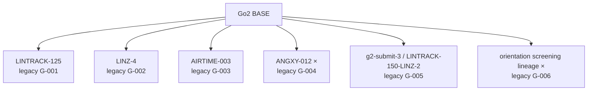

# Experiment Registry

## 2026-10-15 다음 가설 권고 수납 — 새 Run 없음

[원문·검토·한계](../data/processed/experiments/h1/analysis/2026-10-15_H1_NEXT_HYPOTHESIS_DECISION_INTAKE.md). 옛 lin=.65 resume4650/SHA `ce7ad586…` 대 무변경4699의 **기존 CSV 교차 비교 완료**: H5 진행 평균 +1.626684m(384/384건 증가), H4 yaw 오차 +.087164rad/s·H3 world 잔류 +1.816354m로 trade-off/HOLD 유지다. 원 episode 재집계·인과 검증과 구분한다. 다음 **외부 권고**는 부모2700에서 lin=.55/action=-.0001 유지 +2K, 차선은 h1-submit-2 + action=-.0003 fresh3K다. 사용자 미선택이므로 Experiment/Run ID·PLANNED 실행을 발급하지 않았고 기존 계획도 대체하지 않는다. [Optuna 도구 검토](../data/processed/operations/2026-10-15_OPTUNA_EXTERNAL_CPU_REVIEW_INTAKE.md)는 별도 수납 완료, 개선본·실사용 미완료이며 실제 trial/학습은 생성하지 않았다.

## 2026-10-15 부모2700·무변경4699·복원4650 CPU 비교 완료

[원문・CSV・수납](../data/processed/experiments/h1/analysis/2026-10-15_ACTRATE_PARENT_UNCHANGED_RESTORATION_COMPARISON_INTAKE.md). 외부 에이전트가 기존 PERSONAL Windows 평가 3개를 CPU 비교했다. 무변경4699는 부모2700보다 H5 진행384/384건 감소해 **현재 세 후보의 범용·전진/험지 대표 선정에서 REJECT**로 갱신한다(정지/yaw 참고군·학습 COMPLETED/PASS·원본은 유지). 부모2700과 ACTION 복원4650(`a8249db4…`)은 **HOLD**, PROMOTE 없음. 복원4650은 무변경보다 진행373/384건 개선하지만 tracking283/384건 악화 및 최악4.845m다. 원문/CSV 검토 반영이며 첨부 코드·GPU는 실행하지 않았다. 원 metadata의 imported-parent null/unverified·checkpoint 선택 차이·인과 미확정은 유지한다.

## 2026-10-15 H1 두 정책 행동 보고서 수납 · HOLD (기존 평가 자료의 사후 해석)

[MODEL4650+LINTRACK-065 통합 검토](../data/processed/experiments/h1/analysis/2026-10-15_H1_MODEL4650_LINTRACK065_POLICY_REVIEW.md) 및 [MODEL4650 원문](../data/processed/incoming/other/reviewed/H1_MODEL4650_POLICY_ANALYSIS_20261015.md) · [LINTRACK-065 원문](../data/processed/incoming/other/reviewed/H1_LINTRACK-065_POLICY_ANALYSIS_20261015.md)을 수납했다. **이번 작업은 MD 보고서 근거 반영이며, 원본 평가 ZIP/MP4의 재분석·GPU 실행이 아니다.** 두 보고서는 각자 동일 규격 PERSONAL `scenario7` 3,072/3,072 timeout, 접촉 종료 0을 기술한다. 두 정책 모두 **전지형 후보 HOLD**.

- **ACTION 복원 / `model_4650` SHA `a8249db4…25b84ea`**: OFFICIAL resume Run `20261014-142200-h1-actrate-return2700-2k`에 외부 checkpoint SHA/index로 연결. H1 body 전진 0.282m·H3 world 최종 순변위 0.167m이나 H5 rough 진행 평균/P05/최소 **8.769/7.970/4.845m**, stall>0.05 **7/384**. `model_4699` terminal과 **다르고**, 이전 10/11 ACTRATE→lin=.65 `model_4650` SHA `ce7ad586…9dea70`와도 다르다. Imported-parent evidence의 null/unverified는 변경하지 않는다.
- **LINTRACK-065 fresh5K / `model_4950` SHA `b7528923…ece`**: OFFICIAL fresh Run `20261014-081901-h1-lintrack-065-fresh5k`에 외부 index/SHA로 연결. H1 body 누수 0.063m, H2 전진 15.088m이나 H3 world 최종 순변위 **3.102m**, H5 rough 진행 평균/P05/최소 **8.995/8.411/7.943m**로 전천후 적용 HOLD. `03_boxes.mp4`의 검정 교대 프레임은 보고된 캡처 artifact이며 정책 종료로 세지 않는다.
- **현재 대조 상태:** 부모2700/무변경4699/ACTION 복원4650(`a8249db4…`)의 CPU 비교는 위 보고서로 완료됐다. LINTRACK fresh와 TERM-50 `model_2800`의 대조는 이번 입력이 아니다. 같은 protocol ID만으로 동등한 물리 지형·원인 효과·공식 점수는 입증되지 않는다.

아래 ‘HOLD / 분석 대기’는 **2026-10-15 원문 수납 이전 상태**다. OFFICIAL 학습 종료·개인 평가 완료·보고서 판정·대회 제출과 채점은 서로 다르다.


## 2026-10-15 H1 세 정책 PERSONAL Windows 영상·평가 완료

아래는 기존 OFFICIAL 학습의 사후 PERSONAL 평가이며 신규 학습 Run이나 공식 점수가 아니다. 각 통합 ZIP은 6영상 + camera-off H1 scenario7 full evaluation(128 envs, seeds 4201/4202/4203, eight cases, non-smoke)을 포함한다. 보고서 수납 후 CPU 비교에서 무변경4699만 현재 범용·전진/험지 대표 후보 REJECT로 갱신됐고, 복원4650과 별개 fresh4950은 HOLD다. 옛 lin=.65 resume4650 대 무변경4699는 이후 위 다음 가설 보고서에서 기존 CSV 수준으로 비교됐다.

| Experiment / source training Run | 평가 checkpoint | PERSONAL 평가 Release |
| --- | --- | --- |
| `exp-h1-action-rate-relaxation` / `20261014-111135-h1-actrate-0001-unchanged-cont2k` | model_4699 | [무변경 +2K](https://github.com/SE3C/naver-issacsim-eval/releases/tag/private-h1-20261015-exp-h1-action-rate-relaxation-model4699-video-eval) |
| `exp-h1-action-rate-restoration` / `20261014-142200-h1-actrate-return2700-2k` | model_4650 (학습 terminal 4699와 구별) | [action-rate 복원 +2K](https://github.com/SE3C/naver-issacsim-eval/releases/tag/private-h1-20261015-exp-h1-action-rate-restoration-model4650-video-eval) |
| `exp-h1-planar-tracking-weight` / `20261014-081901-h1-lintrack-065-fresh5k` | model_4950 | [LINTRACK-065 fresh5K](https://github.com/SE3C/naver-issacsim-eval/releases/tag/private-h1-20261015-exp-h1-planar-tracking-weight-model4950-video-eval) |

ZIP 내부 `source_run_id=null`은 원문 그대로 보존하고, 외부 연결은 source checkpoint SHA와 OFFICIAL checkpoint index를 근거로 기록한다. 두 resume 학습의 imported-parent provenance 한계도 그대로 유지한다. 아래 10월 14일의 평가 대기 표현은 이 수납 이전 상태다.

## 2026-10-14 H1 action-rate restoration after ACTRATE-0001 · OFFICIAL resume +2K

- [Experiment detail](experiments/h1/exp-h1-action-rate-restoration.md): Run `20261014-142200-h1-actrate-return2700-2k`, resumed from iteration 2700 for +2K, final 4699/4700, seed 42 / 4096 envs, exit 0, COMPLETED/PASS. `action_rate_l2` is restored from `-0.0001` to the h1-submit-2 baseline `-0.0005`; the other eight archived rewards match the ACTRATE-0001 parent.
- Input SHA matches preserved OFFICIAL ACTRATE-0001 fresh3K `model_2700.pt`, but this Run's raw evidence retains null parent/evidence IDs and `source_provenance_verified=false`. Same-parent unchanged-reward control is Run `20261014-111135-h1-actrate-0001-unchanged-cont2k`; no policy evaluation or adoption decision yet.
- [Canonical evidence and Release](https://github.com/SE3C/naver-issacsim-originals/releases/tag/official-h1-20261014-exp-h1-action-rate-restoration-resume2700-plus2k).

## 2026-10-14 H1 ACTRATE-0001 unchanged continuation control · OFFICIAL +2K

- [Existing experiment detail](experiments/h1/exp-h1-action-rate-relaxation.md): Run `20261014-111135-h1-actrate-0001-unchanged-cont2k`, OFFICIAL H1 resume from iteration 2700, 2000 additional requested / final 4699, seed 42 / 4096 envs, exit 0, COMPLETED/PASS. All nine archived reward values match ACTRATE-0001 fresh3K `model_2700` config; this is the unchanged-reward control, not a reward-change run.
- Parent checkpoint SHA `e54d3389e20ea913968ef8d3edbea5004368ff225fa6b94f73fcd91cf93ca7ae` matches preserved OFFICIAL ACTRATE-0001 `model_2700.pt`. Raw Run metadata still records `user_imported_checkpoint`, null parent/evidence IDs, and `source_provenance_verified=false`; the external hash match does not alter those fields. Policy evaluation remains pending/HOLD.
- [Canonical evidence and Release](https://github.com/SE3C/naver-issacsim-originals/releases/tag/official-h1-20261014-exp-h1-action-rate-relaxation-unchanged-cont2k).

## 2026-10-14 H1 planar tracking weight · OFFICIAL fresh 5K

- [Experiment detail](experiments/h1/exp-h1-planar-tracking-weight.md): Run `20261014-081901-h1-lintrack-065-fresh5k`, fresh from `h1-submit-2`, with final reward override `track_lin_vel_xy_exp 0.50→0.65` only. Seed 42, 4096 envs, 5000 requested (console reaches 4999/5000), exit 0, COMPLETED/PASS; no parent checkpoint. Full resolved config and source identity are in the evidence archive.
- [Canonical Originals evidence and Release](experiments/h1/exp-h1-planar-tracking-weight.md#evidence-and-current-decision). Policy evaluation and adoption decision remain pending/HOLD; no submission or official score is claimed. This is distinct from the existing ACTRATE-parent LINTRACK-065 resume Run.

## 2026-10-14 ACTRATE-0001 fresh 조합 두 건 수납

- [action + feet=0.25](experiments/h1/exp-h1-action-airtime-fresh-interaction.md): Run `20261013-144616-h1-actrate0001-airtime025-fresh3k`, OFFICIAL fresh3K COMPLETED/exit0/PASS, seed42/4096env/no parent. Indexed model2950 SHA `14fd9ad4…affd6`로 PERSONAL full 6영상·평가를 연결했다.
- [action + feet_slide=-0.35](experiments/h1/exp-h1-action-foot-contact-stability.md): Run `20261013-153313-h1-actrate0001-feet_slide-fresh3k`, OFFICIAL fresh3K COMPLETED/exit0/PASS, seed42/4096env/no parent. Indexed model2950 SHA `c4b28350…a1374`로 PERSONAL full 6영상·평가를 연결했다.

학습·평가 완료와 채택/분석/공식 점수는 별개다. 두 건 모두 **HOLD / 심층 분석 대기**이며 새로운 제출 preset이나 보상 인과 결론은 발급하지 않는다. 두 model2950은 같은 정책이 아니다. 아래 과거 PLANNED는 이 수납 이전 상태다.

> **현재 상태 조회 안내 (2026-10-12):** 최근 확인된 H1 Round-6 `h1-submit-6`까지 제출 preset label은 **5개** (`h1-submit-2`, `h1-submit-4`, `h1-submit-6`, `g2-submit-3`, `g2-submit-5`)다. 그중 `g2-submit-5`는 native `agent.yaml` 사본이 미동결이다. 아래의 `기존 세 제출` 및 `PLANNED` 같은 과거 문장은 해당 분석 시점의 기록이며 이 최상단의 신규 제출 확인을 덮어쓰지 않는다. **학습 완료·PERSONAL 평가의 행동 HOLD·실제 제출·공식 점수는 별개**다. [preset/불확실성](submission_presets/README.md) · [명명 규칙](EXPERIMENT_NAMING.md) · [질문별 파일 구조](experiments/README.md).

## 2026-10-11 H1 Round-6 submitted — h1-submit-6 / ACTRATE-0001

The user explicitly confirmed actual Round-6 submission completion on 2026-10-11. [Submission snapshot/manifest](../data/processed/experiments/h1/2026-10-11_PRELIM_R6_SUBMISSION/submission_manifest.json) · [Release](https://github.com/SE3C/naver-issacsim/releases/tag/submission-h1-prelim-r6-20261011) · [frozen native configuration](submission_presets/h1-submit-6/). Exact portal time/receipt and official score are not supplied.

Existing `exp-h1-action-rate-relaxation`, OFFICIAL fresh10K Run `20261011-041745-h1-actrate-0001-fresh10k-official`: completed/exit0/PASS, seed42/4096env, 10,000 requested iterations, final native iter9999, no parent/resume. Submitted policy SHA `d304f5d51726cd48e0fda377cb4db2b72a93c65cc38344a85d6feae68d63365a` loads as TorchScript and all eight actor tensors exactly match indexed keeper model_9999 SHA `a5020c273bc2b69bea1b20782fe80ba6605b3036b4054a7e5a8ab66151d2cb74`. Submitted env SHA `91f07d0be9d705cba9bade6c1ff3f9117286c9d7c04af7d9a6ea05df964cedc7` matches the official native configuration. Relative to prior h1-submit-4: feet0.25→0.20, action-0.0005→-0.0001; relative to h1-submit-2, the displayed reward override is action=-0.0001. Full native env/agent files, not this shorthand, define the immutable h1-submit-6 preset.

The previous PERSONAL report HOLD remains its analytical decision; user-selected actual submission is a separate status, not inferred PROMOTE. Source auto-best model_9900 is distinct. The historical evaluation/intake sections below predate this submission confirmation. Complete raw training evidence and received submission bytes remain canonical in Originals; no native checkpoint is duplicated as a submission Release asset.

## 2026-10-11 ACTRATE-0001 fresh10K model_9999 PERSONAL evaluation received

The already registered OFFICIAL fresh10K Run `20261011-041745-h1-actrate-0001-fresh10k-official` now has a separate PERSONAL Windows six-video/full H1 scenario7 bundle for indexed keeper `model_9999.pt`, SHA `a5020c27…cb74`. 3,072 episode rows, complete/non-smoke, 18 files/CRC PASS. [Publication / canonical raw / Release](../data/processed/operations/windows_h1_video_evaluation/2026-10-11_ACTRATE0001_FRESH10K_MODEL9999_PUBLICATION.md). **User policy analysis received; report decision HOLD**: [original and review](../data/processed/experiments/h1/2026-10-11_ACTRATE0001_MODEL9999_POLICY_REVIEW.md). All 3,072 survive20s; H1/H3 world residual0.287/0.395m, H2 forward14.885m, H7 push9.974m; rough mean/P05/min8.915/8.251/6.492m is the principal tail weakness. Evaluation and analysis completion are not an official score, submitted-policy or reward-effect claim. This is not the automatic-best model_9900 or historical fresh3K/model_2700.

## 2026-10-11 ACTRATE-0001 OFFICIAL fresh 10K received — COMPLETED/PASS

Historical training-intake status below; the later model_9999 evaluation and user analysis received/HOLD status is recorded in the preceding section.

Existing [`exp-h1-action-rate-relaxation`](experiments/h1/exp-h1-action-rate-relaxation.md), separate Run `20261011-041745-h1-actrate-0001-fresh10k-official`: OFFICIAL fresh, requested 10,000 iterations, seed 42, 4096 envs, no parent/resume; metadata completed, exit 0, validation PASS. Checked reward display `h1-submit-2 + action=-0.0001`; full native params/reward/source remain in the immutable archive. 201 keeper checkpoints preserved; automatic best `model_9900.pt` SHA `6dd795e3…c769d` is distinct from report peak-reward step 9880. [Intake / original SHA / canonical preservation / Release](../data/processed/experiments/h1/2026-10-11_ACTRATE0001_OFFICIAL10K_EVIDENCE_INTAKE.md). **10K policy analysis pending/HOLD**, not a submitted policy or official score. Earlier fresh3K/model_2700 evaluation is not 10K evidence.

## 2026-10-11 ACTRATE-001 / model_2850 (SHA `1e6d…bb1`) PERSONAL 행동 분석 수납 — HOLD

[원문 그대로 보존](../data/processed/incoming/other/reviewed/H1_MODEL2850_SHA1E6D_POLICY_ANALYSIS_20261010.md) · [해석/정책 검토](../data/processed/experiments/h1/2026-10-11_ACTRATE001_MODEL2850_POLICY_REVIEW.md) · [기존 Experiment/Run](experiments/h1/exp-h1-action-rate-smoothing.md). OFFICIAL fresh3K `ACTRATE-001` Run `20261010-125324-h1-actrate-001-fresh3k`의 best `model_2850.pt` SHA-256 `1e6d0950f5bd981ca1f88044e65ae7ee57505c47b92b5caad8c39263f4d93bb1`는 Windows PERSONAL 6영상/`scenario7` 평가 SHA와 일치한다. ZIP 내부 `source_run_id=null`은 보존했고 같은 이름의 ORIENT-100 `model_2850` SHA `6aed…f7b0`와 분리했다. **3,072/3,072개의 20초 생존**과 H2 전진 15.470m / H7 push 10.656m는 이동 능력을 뒷받침하지만 정지 H1 world XY 평균 **1.151m**, 횡왕복 H3 world XY 평균 **2.177m** 잔류, rough H5 전진 P05 **8.921m** 및 중앙 다단 계단의 확인 공백이 남는다. **전지형 대표 정책 HOLD**; 추정 reward 인과/공식 점수/새 training Run/Optuna trial로 승격하지 않는다. 1순위 기존자료 비교는 `h1-submit-2 / TERM-50 model_2800` raw의 protocol/source/command/terrain/seed parity 검토 후 대응 cohort 비교이며 이번 수납에서 새 GPU 작업은 실행하지 않았다.

## 2026-10-10 selected five H1 ACTRATE-0001 hypotheses — one completed intake, four PLANNED

[Selected five-hypothesis planning document](../data/processed/planning/2026-10-10_H1_ACTRATE0001_FIVE_COMBINATION_HYPOTHESES.md) preserves the original proposals; separate `ACTRATE-001` / `exp-h1-action-rate-smoothing` is **not** one of these five. On 2026-10-11 the planar-tracking resume evidence and PERSONAL evaluation were received and published; the other four remain PLANNED. No submission, policy adoption or Optuna result is implied.

Temporal note: the dated analysis sections below preserve the status available when written; their `ACTRATE-001` PLANNED/no-Run statements predate the verified training intake in the current status section and are not current status.

| Experiment question | Training mode | Final `h1-submit-2` preset-relative override | Status |
| --- | --- | --- | --- |
| [`exp-h1-action-airtime-fresh-interaction`](experiments/h1/exp-h1-action-airtime-fresh-interaction.md) | OFFICIAL **fresh 0→3K** | `feet=0.25 + action=-0.0001` | Run `20261013-144616-h1-actrate0001-airtime025-fresh3k`: COMPLETED/PASS; PERSONAL model2950 evaluation COMPLETE; analysis pending/HOLD |
| [`exp-h1-action-foot-contact-stability`](experiments/h1/exp-h1-action-foot-contact-stability.md) | OFFICIAL **fresh 0→3K** | `action=-0.0001 + feet_slide=-0.35` | Run `20261013-153313-h1-actrate0001-feet_slide-fresh3k`: COMPLETED/PASS; PERSONAL model2950 evaluation COMPLETE; analysis pending/HOLD |
| [`exp-h1-action-first-airtime-switch`](experiments/h1/planned/exp-h1-action-first-airtime-switch.md) | OFFICIAL **resume, ACTRATE-0001 3K→+2K** | `feet=0.25 + action=-0.0001` | PLANNED; no Run ID |
| [`exp-h1-action-first-planar-tracking-switch`](experiments/h1/exp-h1-action-first-planar-tracking-switch.md) | OFFICIAL **resume, ACTRATE-0001 model_2700→+2K** | `lin=0.65 + action=-0.0001` | Run `20261010-154926-h1-actrate0001-lintrack065-from2700-plus2k`: COMPLETED/PASS; model_4650 PERSONAL evaluation COMPLETE; analysis received/HOLD |
| [`exp-h1-action-first-body-rate-switch`](experiments/h1/planned/exp-h1-action-first-body-rate-switch.md) | OFFICIAL **resume, ACTRATE-0001 3K→+2K** | `angxy=-0.08 + action=-0.0001` | PLANNED; no Run ID |

**User constraint correctly interpreted:** independent Resume Runs are allowed **many times**, but each child branch makes only **one resume step** from the existing common 3K parent; none is further resumed from 5K to 7K. The three branches reference OFFICIAL ACTRATE-0001 fresh3K Run `20261009-142350-h1-actrate-0001-fresh3k`, not another child. The completed planar branch imported `model_2700` with matching parent SHA; latest parent `model_2950` is distinct. Remaining branches require actual checkpoint selection and evidence; do not infer their execution. Original standalone-import provenance remains unverified in raw metadata and is linked externally by SHA only.

Fresh AIRTIME+ACTRATE and AIRTIME-after-ACTRATE have **identical final reward but different training histories**. Fresh 3K vs total approximately 5K resume cannot establish training-order causality. Primary controls: Fresh against existing ACTRATE-0001 fresh3K; each resume against same-parent reward-unchanged +2K when separately authorized/available. Both source/PPO/evaluator parity and H1/H3/H4/H5/H6/H7 safety/tracking must be checked. The new Full field `feet_slide` is used instead of inventing a descriptor. Existing H-010 LINTRACK+AIRTIME historical experiments are a *different parent/config*, not a completed implementation of these plans. No new GPU work requested here.


> **계보 구분:** 2026-09-21에 정정한 과거 PERSONAL legacy H-001 R04는 feet=-0.2이며 그 자식 Run은 역사적 상대 비교용이다. 2026-09-25 새 `feet=+0.2` corrected `TERM-50` parent(legacy H-001 R05)와 그 자식 `AIRTIME-025`·`AIRTIME-030`·`LINTRACK-100`·`LINTRACK-075` corrected PERSONAL branches(legacy H-005~H-008)는 완료되었으며 아래에 별도 기록한다. 둘을 합치거나 공식 TERM50 제출 결과로 취급하지 않는다. [과거 계보 정정](../data/processed/experiments/h1/2026-09-21_H1_PARENT_AIRTIME_LINEAGE_CORRECTION.md) / [새 비교 원문](../data/processed/incoming/other/reviewed/H1_H005_VS_H006_DEEP_ANALYSIS_20260925.md).

이 문서는 H1·Go2 실험의 현재 판단과 근거 위치를 관리하는 프로젝트 대시보드다. **새 명명 규칙은 [Experiment naming](EXPERIMENT_NAMING.md)**을 따른다. 기존 세 제출의 전체 native 설정 복사본·출처·해시는 [submission presets](submission_presets/README.md)에 동결했다. 2026-10-06 사용자가 Go2 Round-5 실제 제출을 확인해 `g2-submit-5 / LINTRACK-125` 이름을 발급했으며, 제출 snapshot은 보존됐지만 full preset의 `agent.yaml` 복사본은 canonical OFFICIAL 7.5K archive에서 byte-for-byte 추출하기 전까지 materialize하지 않는다. 아래의 `H/HS/G/GS` 표와 `Rxx`는 이미 존재하는 기록의 legacy 주소이지 신규 ID 발급 규칙이 아니다. 실제 policy, checkpoint, TensorBoard, video와 evidence archive는 이곳으로 옮기지 않는다. canonical 원본의 보관 대상은 `naver-issacsim-originals`, 상세 해석 위치는 `data/processed/experiments/`와 `data/processed/incoming/`이다. 단, 2026-09-25·27 PERSONAL H1 archive는 현재 로컬 Originals Git 경로에서 확인되지 않았으므로 NVIDIA private Release mirror를 Originals 수납 완료와 혼동하지 않는다. [9/27 보존 상태](../data/processed/experiments/h1/2026-09-27_H1_FRESH_AND_CONTINUATION_EVIDENCE_INTAKE.md).

가설의 현재 판단 상태는 이 대시보드의 표를 기준으로 한다. 실행 중 batch 상태는 잠정 운영 기록이며, 완료·실패 여부는 evidence를 확인한 뒤 개별 실험 파일과 이 표에 함께 반영한다. 별도 상태 YAML은 만들지 않는다.

## 2026-10-10 ANGTRACK-065 vs TERM-50 RAW 대응-index 추가 검증 — 완료, policy HOLD

- [신규 직접 대조 심층 보고서](../data/processed/experiments/h1/2026-10-10_H1_ANGTRACK065_TERM50_DEEP_RAW_COMPARISON.md). 원문 앞부분의 “채팅 작업 공간에만 보관”은 **분석 작성 당시의 보관 상태**이며 이 GitHub 수납 후에는 현재 상태를 뜻하지 않는다. 본문은 작성된 분석 원문 그대로 보존했다. 기존 보존 ZIP `TERM-50/model_2800`과 `ANGTRACK-065/model_2950`의 SHA·CRC, 동일 평가 `resolved_configs.json`/protocol/agent/source/applied-env fingerprints 및 **3,072 최초 cohort 키 완전 대응**을 재확인했다. ANGTRACK은 최초 3,072행 외에 **H3 접촉 종료에 따른 15개 짧은 재시작 행**이 별도로 있으므로 `-n0` 최초 시도만 TERM 3,072행과 대응시켰다. 이는 신규 GPU 학습/평가/비디오가 아닌 기존 `episodes.jsonl`의 CPU 분석이다.
- **H3 lateral 실패:** TERM **0/384** vs ANG **15/384** 최초 cohort base-contact 종료. 최초 384개 기준 `vy_error` **0.06848 → 0.18601**, stall **0.00912 → 0.34339**. 정상 20초 완료 ANG 369개만 남겨도 `vy_error=0.18087`, stall `0.33889`로 약점이 지속. **384/384 대응 인덱스 모두** ANG의 vy error와 stall이 TERM보다 높았다.
- **yaw 이점·trade-off:** H4 yaw abs error **0.11934 → 0.07704**(ANG 약 35.45% 낮음; 384/384 대응 인덱스 우세). 전 8case 최초 cohort 혼합 tracking **0.157118 → 0.130669**, yaw error **0.114376 → 0.064730**이지만 `vy_error` **0.060848 → 0.069613**와 `xy_rmse` **0.112589 → 0.125612**는 악화. H1 비의도 body 전진 **1.3523→0.8751m** 감소. H5 평균 진행 **8.8961 vs 8.8949m** 사실상 동일; H5 진행 우세 인덱스 ANG **179/384** vs TERM **205/384**, 최악 진행 TERM **2.6391m**, ANG **7.7253m**. H6 진행량은 ANG에서 감소.
- **판정:** `ANGTRACK-065` 회전·정지 이점은 인정하지만 **횡이동 지시를 동반하는 전방위 대표 채택 HOLD**. 최초 cohort 중 ANG 실패 15행은 20초 미만이므로 tracking 단순 평균을 동일 시간/공식 점수로 보지 않는다. **동일 cohort 키≠물리 초기 지형·state 완전 동일**, training source/PPO/독립 훈련 seed에 대한 reward 인과도 미확정. `ACTRATE-001`은 PLANNED 상태 그대로.

## 2026-10-10 ANGTRACK-065 model_2950 PERSONAL 심층 행동 분석 수신 — HOLD

- [사용자 제공 보고서 원문](../data/processed/incoming/other/reviewed/H1_ANGTRACK-065_POLICY_ANALYSIS_20261010.md) / [출처·행동 판정 요약](../data/processed/experiments/h1/2026-10-10_ANGTRACK065_MODEL2950_POLICY_REVIEW.md). 기존 `exp-h1-angular-tracking-boost` OFFICIAL fresh3K Run `20261009-155344-h1-angtrack-065-fresh3k` (exit0/PASS, seed42/4096env) auto-best=latest keeper `model_2950.pt`, checkpoint SHA `6a6f456eb3f25a7d2764af576e30b1a8169674256ae5c2ba0a1b79ed368e118c`의 **후속 PERSONAL 영상+camera-off 평가 분석**이다. 학습 Run 추가가 아니며 ZIP의 null source IDs는 수정하지 않는다.
- **핵심 H3 실패:** 8case×3seed×128env = 최초 **3,072 cohort**이나 H3 초기 cohort **15/384(3.91%) base-contact 종료** 후 각 1회 restart로 `episodes.jsonl`이 **3,087행**. H3 원본 20초 timeout 완료는 **369/384=96.09%**. 행 기준 `384/399=96.24%` 생존에는 짧은 `evaluation_end` 15행이 포함되므로 20초 완주율로 쓰지 않는다. H3 tracking **0.2203**(399행 평균), stall **0.3532**, `vy_error=0.1871m/s`. H1 정지 body 비의도 전진 **0.875m**, world 순변위 중앙값 **0.899m**.
- **확인된 이동:** H2 전진 **14.703m**, H4 yaw 절대오차 **0.0770rad/s**, H5 rough 평균/P05/최소 전진 **8.895/8.399/7.725m**, H6 10° 상/하 **19.571/19.235m**, H7 push **9.996m**(각 body-frame). 6개 영상은 별도 명령·지형에서 박스/rough 초반 이동을 뒷받침하지만 순수 H3 lateral이나 계단 다단 중앙 통과를 증명하지 않는다. `06_slope_down_10deg.mp4`의 짝수 500 검정 프레임은 **캡처 결함**이다.
- **판정:** ALL-TERRAIN / 횡이동 대표 후보는 **HOLD**. 사용자 제공 단일정책 보고서가 분석한 ZIP 외의 정책들을 이번 수납에서 직접 대조하지 않았으므로, 기존 `TERM-50/model_2800` 원자료를 **1순위 대조 후보**로 보존하되 ANGTRACK↔TERM matched raw A/B·reward 인과·공식 점수는 미실행/미확정이다. `ACTRATE-001` PLANNED 유지. 새 GPU 실행·영상 생성·export 없음.

## 2026-10-10 H1 고정 `scenario7` 원본 9,216 episode 직접 대응 비교 — 완료 (정책 HOLD)

- [새 원자료 기반 3정책 종합 분석](../data/processed/experiments/h1/2026-10-10_H1_SCENARIO7_RAW_3POLICY_MATCHED_ANALYSIS.md) · [case 집계 JSON](../data/processed/experiments/h1/2026-10-10_H1_SCENARIO7_RAW_SUMMARY.json) · [대응 index delta JSON](../data/processed/experiments/h1/2026-10-10_H1_SCENARIO7_PAIRED_DELTAS.json). 사용자로부터 기존 GitHub의 TERM-50 `model_2800`·ORIENT-100 `model_2850`·ACTRATE-0001 `model_2700` PERSONAL Windows ZIP **3개를 수신하여 직접 열었다**. ZIP SHA-256 GitHub 보존 manifest와 3/3 일치, ZIP CRC/testzip 3/3 PASS, `episodes.jsonl` **3,072×3=9,216행**, policy별 8 case×384 row, cohort key 완전 일치(중복 0). `resolved_configs.json` **바이트 동일**, protocol/agent/source/applied-env fingerprints 일치. 모든 평가 20초 timeout **3,072/3,072**; 기존 자료 보존, 신규 train/evaluator GPU 실행 없음.
- **TERM-50 raw baseline 신규 확인:** 전체 tracking `0.15712`, H1 zero command 비의도 body 전진 `1.352m`, H5 rough 평균/P05/최소 `8.896/8.533/2.639m`, rough 극단 stall `0.611`(seed4201/env16). baseline ZIP이 존재한다는 확인을 넘어 **case raw 수치 확보·대응집계까지 완료**했다. 이전 문서의 “baseline case 자료 미추출”은 수신 전 시점 기록이다.
- **ORIENT-100:** 전체 tracking `0.14041`(TERM 대비 `-10.63%`), rough 평균 `9.451m`, H1 정지 비의도 전진 `1.633m`로 기준보다 많음. `action_delta_rms` 전체 `0.35759` vs TERM `0.36529`이지만 **roll_pitch_rms 전체 `0.08015` vs TERM `0.03381`**로 매우 큼. 같은 평가 전체 8-case roll/pitch RMS가 기준과 ACTRATE보다 높아 “균형 최상”이라는 해석 금지.
- **ACTRATE-0001:** 전체 tracking `0.14534`(TERM 대비 `-7.50%`), H5 rough 평균/P05/최소 `9.948/9.592/8.815m`, H5 대응 코호트 진행 증가 **384/384**. 대신 H1 정지 비의도 전진 `1.987m`, H3 횡이동 중 전진 `1.677m`, 전체 action Δ RMS `0.45687`로 가장 큼. 동일 지표로 TERM·ORIENT의 단일 장점을 합성한 결과가 아니라 별도 정책 행동 특성이다.
- **판정:** 3개 모두 내부 전지형 대표 선택은 **HOLD**. ORIENT는 composite tracking, ACTRATE는 rough 실제 진행, TERM은 H1 정지/자세 비용의 대조축. 동일 평가 설정과 cohort **인덱스** 대응이 확인됐지만 개별 물리 terrain/reset/rollout trajectory 동일성과 OFFICIAL 훈련 전체 source·PPO parity, independent training seed 반복, checkpoint 저장 시점 동일성은 미검증. reward 변경 인과/공식 점수로 오인하지 않는다. ANGTRACK-065 PERSONAL full 평가(3,087 episode행) 및 단일 정책 분석 수신·HOLD, ACTRATE-001 PLANNED.


## 2026-10-10 H1 3정책 보고서 비교 + `TERM-50` 고정 평가 ZIP 존재 확인

- [GitHub 원본 ZIP 세 건·provenance·8-case 비교/접근 한계](../data/processed/experiments/h1/2026-10-10_H1_SCENARIO7_CROSS_POLICY_REPORT_LEVEL_COMPARISON.md). **`h1-submit-2 / TERM-50 model_2800`** PERSONAL Windows full `scenario7` ZIP이 GitHub Originals LFS 및 `naver-issacsim-nvidia` Release에 보존돼 있다. `ORIENT-100/model_2850`, `ACTRATE-0001/model_2700`도 각기 존재하며 Originals publication manifests를 직접 읽어 evaluator task `ef10b7a`, handoff `28895d7`, protocol SHA `d406a296…7062d34`, 평가 3 seeds×128 env×8 case×20 s를 대조했다. **원본 ZIP 바이너리는 현재 GitHub 연결로 내려받을 수 없어 `episodes.jsonl` raw/cohort 비교를 실제 실행하지 않았다.** baseline case 수치는 아직 없는 것으로 기록한다.
- **별도 보고서 기반 관찰:** ORIENT는 ACTRATE보다 8개 중 **5 case tracking**과 세 후보 비교 시 **8/8 action-change RMS**에서 낮은 수치를 보인 균형·부드러움 후보. ACTRATE는 H2/H6 tracking, H5 mean/P05 진행(`9.948/9.592m`, ORIENT `9.451/8.863m`)의 험지 진행 후보. H1 zero 명령 body 비의도 전진 ORIENT `1.633m` vs ACTRATE `1.987m`, H3 lateral ORIENT `1.180m` vs ACTRATE `1.677m`. `LINTRACK-075/model_4997`은 PERSONAL corrected5K라 reward 인과 대조에 넣지 않고 특성·실패 꼬리 참고로만 둔다. 사례별 차이는 matched 동일 terrain 통계나 개선율로 읽지 않는다.
- **현 판정:** ORIENT/ACTRATE/LINTRACK 모두 전지형 대표 **HOLD**. TERM-50 baseline의 실제 `episodes.jsonl`을 포함해 세 기존 ZIP을 같은 `(scenario,case,seed,env_id)`로 조인하고 effective config·initial-state/terrain/source/PPO parity를 확인한 뒤에만 reward 개선·정책 채택 결론을 검토한다. `ANGTRACK-065` 평가/단일 정책 분석 수신·HOLD, `ACTRATE-001` PLANNED, 신규 training Run/Optuna/공식 점수 없음. **이 등록은 GPU 실행도 아니다.**

## 2026-10-10 ACTRATE-0001 model_2700 PERSONAL 정책 분석

- [사용자 제공 분석 원문](../data/processed/incoming/other/reviewed/H1_MODEL2700_POLICY_ANALYSIS_20261010.md) / [핵심 해석과 판정](../data/processed/experiments/h1/2026-10-10_ACTRATE0001_MODEL2700_POLICY_REVIEW.md). 기존 OFFICIAL `20261009-142350-h1-actrate-0001-fresh3k` 자동 best `model_2700.pt` SHA와 Windows PERSONAL 영상·평가 정책 SHA가 일치한다. 이는 추가 학습 Run이 아니다.
- 평가 COMPLETE: 3,072/3,072 episode 20초 생존, base-contact 종료 0. H2 body 전진 15.326m, H7 push 10.542m, H6 10° 상/하 20.052/19.834m. 그러나 H1 정지 명령의 비의도 전진 1.987m, H3 횡이동 명령의 비의도 전진 1.677m, H5 rough worst-case 전진 8.815m·tracking 0.2908·자세 RMS 0.0999, 계단 다단 통과 미확인이 남는다.
- **정책 HOLD:** 전진형 후보로 보존하지만 전천후 후보 승격, reward 인과 개선, 공식 점수 주장은 보류. 기존 `h1-submit-2/TERM-50 model_2800` 자료가 1순위 대조이며 `ORIENT-100 model_2850`은 별도 행동 후보 참고군. 동일 evaluator/protocol/source/seed/command/terrain/episode 조건의 보존 raw를 먼저 비교하고 신규 GPU는 실행하지 않는다.

## 2026-10-10 H1 `LINTRACK-075` corrected5K / `model_4997` PERSONAL 행동 평가 수신

- 대상은 **기존 PERSONAL corrected legacy H-008 Run 04** `20260925-091257-h1-h008-corrected-control-to5k-h1-corrected-2026`의 final numbered `model_4997.pt` (checkpoint SHA `4349fe5650135c6a77546afc1b165ff60c235bdd83831bd562d618b04c3b5b6d`). 2026-10-09 Windows 6영상 + camera-off `scenario7` 평가의 정책 SHA와 일치한다. **평가 수신은 별도 training Run이 아니다**; 학습 계보 연결은 기존 record와 SHA 확인에 근거하며 ZIP 내부 `source_run_id=null`은 유지한다.
- 첨부된 [전체 행동 분석 원문](../data/processed/incoming/other/reviewed/H1_LINTRACK-075_CORRECTED5K_POLICY_ANALYSIS_20261010.md) 및 [판정 요약](../data/processed/experiments/h1/2026-10-10_LINTRACK075_CORRECTED5K_MODEL4997_POLICY_REVIEW.md): PERSONAL 고정 20초 8 case×3 seeds×128 env **3072/3072 timeout 생존**, H2 body 15.015m/H7 push 10.038m/H6 경사 19.943·19.776m. 그러나 H5 rough 최소 전진 2.8708m/stall 0.664(생존), H1 정지 world 순변위 0.516m, H3 왕복 1.280m, 경사 yaw/action 비용과 다단 계단 검증 공백이 있다.
- **정책 후보 HOLD:** 실제 전진·경사·외란 대응 능력은 유지, 전지형 범용 정책 채택은 보류. 훈련 시계열 우열이나 `track_lin_vel_xy_exp=0.75` reward의 인과 증거, OFFICIAL 점수로 읽지 않는다. 영상과 evaluator는 서로 다른 command/terrain trajectory; evaluator의 기본 `lin=0.5/term=-5` reward 설정은 훈련 reward 증거가 아니다.
- **다음 비GPU 비교:** 보존된 `h1-submit-2 / TERM-50` PERSONAL `scenario7` 결과를 동일 protocol/source/PPO/command/terrain/seed/horizon 기준으로 먼저 확인하고 H5 worst tail 및 정지/횡이동/yaw/action/진행을 cohort 단위로 대조한다. unmatched이면 보류. 상세 계보는 [H-008](experiments/h1/H-008.md).

## 2026-09-30 evaluator status and planned H1 single-dial sequence

**Evaluator status correction:** on 2026-09-30 there was no implemented H1 fixed evaluator / paired-evaluation harness. By 2026-10-04 the shared PERSONAL evaluator core and Windows H1 launchers were implemented, but H1 GPU verification remained absent through 2026-10-06. The 2026-10-07 ORIENT-100 / model_2850 single-policy six-video/full scenario7 evaluation now exists (3,072 timeout-surviving episodes, 0 base-contact failures). The 2026-10-08 OFFICIAL fresh 3K h1-submit-2 / TERM-50 control also has a completed PERSONAL model_2800 six-video/full evaluation under the same recorded protocol, published separately from its OFFICIAL train archive. **HOLD** remains unchanged: two available single-policy records are not a completed paired analysis, source/PPO parity check, official score or reward-effect proof. Older "PROMOTE to fixed paired evaluation" statements indicate evaluation priority, not adoption. The official NCRC score remains the competition result.

The original sequence had two separate single-dial questions: `ORIENT-100` OFFICIAL fresh3K is COMPLETE/PASS with PERSONAL policy HOLD; the ACTRATE-001 plan has since produced the OFFICIAL fresh3K Run recorded below. **2026-10-09 plan update:** add two independent tracking questions (`ACTRATE-0001` and `ANGTRACK-065`). **2026-10-10 verified intake:** ACTRATE-0001 and ANGTRACK-065 are both OFFICIAL fresh3K COMPLETED/PASS (separate Runs; no checkpoint parent). ACTRATE-0001 model_2700 also has a completed PERSONAL six-video/full scenario7 evaluation (3,072 episodes), and a single-policy behavior analysis was received (HOLD), while same-evaluator 3,072-cohort-index raw comparison against unchanged TERM-50 is now complete; repeated-training/effective-terrain matched causal A/B remains unverified. ANGTRACK-065 model_2950 has a completed PERSONAL six-video/full scenario7 evaluation (3,087 episodes); its behavioral analysis is now received (HOLD), with raw matched-control comparison still pending. Both decisions remain HOLD. ACTRATE-001 has an OFFICIAL training Run, its separate Windows PERSONAL video/evaluation is complete, and its single-policy behavior analysis is received (**HOLD**); matched reward-causality and official score remain unverified. Each fresh candidate uses `h1-submit-2` as its reward reference; full source/config parity must be checked, and no parent checkpoints are stacked:

| Experiment | Baseline | Single delta | Target Run | Current comparison | Status | Detail |
| --- | --- | --- | --- | --- | --- | --- |
| `exp-h1-rough-terrain-orientation-relaxation` | frozen `h1-submit-2`; OFFICIAL fresh 3K control `20261008-062732-h1-term-50-fresh3k-control` COMPLETE/PASS | `ORIENT-100` — `flat_orientation_l2 -1.5 → -1.0` only, actual reward weights confirmed | **OFFICIAL fresh 3K COMPLETE/PASS**, seed 42, 4096 env; `20261006-133517-h1-orient-100-fresh3k-official` | PERSONAL model_2850 analysis reports 0/3072 failures but balance/lateral forward drift and rough-tail degradation; model_2800 control six-video/full evaluation now published under the same protocol; paired analysis/source-PPO parity unverified, no reward-effect or official-score claim | **HOLD** | [Runs](experiments/h1/exp-h1-rough-terrain-orientation-relaxation.md) / [analysis](../data/processed/incoming/other/reviewed/H1_ORIENT-100_POLICY_ANALYSIS_20261007.md) |
| `exp-h1-action-rate-smoothing` | frozen `h1-submit-2` | `ACTRATE-001` — `action_rate_l2 -0.0005 → -0.001` only | **OFFICIAL fresh 3K COMPLETED/PASS**, seed 42, 4096 env, no parent; `20261010-125324-h1-actrate-001-fresh3k`, iterations 0–2999 of 3000 requested, exit 0 | PERSONAL six-video/full `scenario7` evaluation COMPLETE on `model_2850.pt` (checkpoint SHA `1e6d0950…f4d93bb1`); 8 cases × 128 env × 3 seeds = 3,072 episode rows across seven scenario groups; behavior analysis received (H1 zero-command drift 1.151m world mean; H3 round-trip world displacement 2.177m; rough H5 P05 body progress 8.921m), **policy HOLD**; not an A/B or official score | **HOLD · OFFICIAL training/PERSONAL behavior evaluation complete** | [Run / canonical evidence / evaluation Release](experiments/h1/exp-h1-action-rate-smoothing.md) |
| `exp-h1-action-rate-relaxation` | frozen `h1-submit-2`; unchanged OFFICIAL fresh3K control completed | `ACTRATE-0001` — `h1-submit-2 + action=-0.0001`; native resolved config archived, nine intended weights confirmed | **OFFICIAL fresh 3K COMPLETED/PASS**, seed 42, 4096 env, no parent; Run `20261009-142350-h1-actrate-0001-fresh3k`, console 2999/3000 | PERSONAL model_2700 six-video/full 3,072-episode evaluation COMPLETE; single-policy behavioral analysis and TERM-50 matched-index raw evaluation comparison received (HOLD; multi-Run/source and physical-reset controlled causality not established); compare unchanged `20261008-062732-h1-term-50-fresh3k-control` after source/PPO parity check; no official-score or adoption claim | **HOLD · training/evaluation complete** | [Run / Release / canonical evidence](experiments/h1/exp-h1-action-rate-relaxation.md) |
| `exp-h1-angular-tracking-boost` | frozen `h1-submit-2`; unchanged OFFICIAL fresh3K control completed | `ANGTRACK-065` — `h1-submit-2 + ang=0.65`; resolved native config archived | **OFFICIAL fresh 3K COMPLETED/PASS**, seed 42, 4096 env, no parent; `20261009-155344-h1-angtrack-065-fresh3k`, console 2999/3000 | PERSONAL model_2950 six-video/full scenario7 evaluation COMPLETE (3,087 episodes); single-policy behavior analysis received (H3 15/384 initial-cohort falls; 3,087 episode rows); control comparison/source-PPO parity pending; prior PERSONAL BASE ANGTRACK-075 collapse is not matched control | **HOLD · training/evaluation complete** | [Run / evaluation / canonical evidence](experiments/h1/exp-h1-angular-tracking-boost.md) |

This plan deliberately returns `feet_air_time` to the `h1-submit-2` value `0.20`; it does not stack `ORIENT-100` on top of Round-4 AIRTIME-025. Round 4 recorded 56.37/70 simulation, 20/20 design-intent analysis and 10/10 report quality; their component sum is 86.37/100, numerically equal to Round-2's total, while weak-rough-terrain score fell 8.17→8.00. The Round-4 source did not expose a separate total field, and the 5K→10K budget change prevents isolating AIRTIME causality; another airtime escalation is therefore not the next priority.

`ACTRATE-001` is the separate `exp-h1-action-rate-smoothing` Experiment and now has one OFFICIAL fresh Run. It is not a resume or child checkpoint lineage: it starts fresh from frozen `h1-submit-2` with only its own single reward delta. The received Run is distinct from `ACTRATE-0001` (`action=-0.0001`). Its separate Windows PERSONAL six-video/full scenario7 evaluation and single-policy behavioral analysis are complete and linked below; policy decision **HOLD** (not reward causality). Evaluation completion alone is not evidence of reward improvement. The `model_2850.pt` filename also occurs for ORIENT-100, so identify this ACTRATE checkpoint by SHA and Run ID. The 2026-10-07 ORIENT candidate decision remains historical HOLD, not evidence about ACTRATE-001.

### 2026-10-10 ACTRATE-001 OFFICIAL fresh3K training intake

- `exp-h1-action-rate-smoothing / ACTRATE-001`: OFFICIAL fresh Run `20261010-125324-h1-actrate-001-fresh3k`, seed 42, 4096 environments, no parent; requested 3000 iterations, completed iterations 0–2999, process exit 0, validation PASS. The full resolved configuration is sourced from `<RUN>/native_run/params/env.yaml` and `<RUN>/native_run/params/agent.yaml`, with source identity in `<RUN>/source/identity.json`; all 12 active reward weights are listed in the detail file. Do not conflate this `action_rate_l2=-0.001` Run with `ACTRATE-0001` at `-0.0001`. Source before/after snapshots match; source commit is unknown and full preset/PPO parity has not been established. Best checkpoint `model_2850.pt` (SHA-256 `1e6d0950f5bd981ca1f88044e65ae7ee57505c47b92b5caad8c39263f4d93bb1`); last preserved `model_2950.pt` (SHA-256 `8914b6b48e74a6463808f629648f87900efdb853e5253e142e99c738adb2d085`). PERSONAL single-policy behavior analysis is now received/HOLD; training-curve causal/matched assessment remains unverified. Separate PERSONAL video/evaluation is recorded below.
- Canonical evidence directory: `naver-issacsim-originals/data/raw/official_server_runs/h1/2026-10-10_215330_actrate001_fresh3k/evidence_archives/`. Outer archive SHA-256 `ab507e1a2b060469413d4f8ada9a4663a5e3eff81cbe0ca85612dd16e5e68966`; size `418745259` bytes. Inner training archive SHA-256 `7265418b6d6843a05a67330ab5300110388b63e7ccc196fb972b93b259770b59`. [Verified OFFICIAL training Release](https://github.com/SE3C/naver-issacsim-originals/releases/tag/official-h1-20261010-exp-h1-action-rate-smoothing-fresh3k) (asset 418,745,259 bytes; SHA-256 `ab507e1a2b060469413d4f8ada9a4663a5e3eff81cbe0ca85612dd16e5e68966`).

- Separate PERSONAL evaluation: `model_2850.pt` SHA-256 `1e6d0950f5bd981ca1f88044e65ae7ee57505c47b92b5caad8c39263f4d93bb1` externally links this evaluation to the existing Run; embedded `source_run_id=null` remains unchanged. COMPLETE, non-smoke; seven scenario groups, with 8 cases × 128 env × 3 seeds (4201/4202/4203) = 3,072 episode rows. ZIP `model_2850_h1_6terrain_evaluation_20261010-233937_1cc2ab9d.zip`, 35,121,564 bytes, 18 files, CRC valid; SHA-256 `1906880030393b904d7323bdbf71352f408a067328a09ac8bf87604438c07351`. This is not an official score or A/B comparison. Canonical Originals backup is `data/raw/official_server_runs/h1/2026-10-10_215330_actrate001_fresh3k/personal_windows_eval_20261010/` at commit `5dcbfe36b3fc6fd014a3eb738b9e56518afd1300`; verified [PERSONAL evaluation Release](https://github.com/SE3C/naver-issacsim-nvidia/releases/tag/private-h1-20261010-exp-h1-action-rate-smoothing-model2850-video-eval) has matching asset size and SHA. See [publication note](../data/processed/operations/windows_h1_video_evaluation/2026-10-10_ACTRATE001_MODEL2850_PUBLICATION.md).

### 2026-10-10 latest intake — ACTRATE and ANGTRACK

- `exp-h1-angular-tracking-boost / ANGTRACK-065` is **OFFICIAL fresh 3K COMPLETED/PASS** and its `model_2950.pt` now has a **PERSONAL six-video/full scenario7 evaluation COMPLETE** (3,087 episodes); single-policy behavior analysis received (HOLD); matched-control comparison remains pending. [Run, evaluation, canonical evidence and Releases](experiments/h1/exp-h1-angular-tracking-boost.md). **HOLD**; no official score or promotion claim.
- `exp-h1-action-rate-relaxation / ACTRATE-0001` model_2700 now has **PERSONAL Windows six-video + full evaluation COMPLETE**, 3,072 episodes, and single-policy behavioral analysis received (HOLD); no official score or completed paired analysis. [Follow-up and Release](experiments/h1/exp-h1-action-rate-relaxation.md). **HOLD** remains.

## 2026-09-27 PERSONAL H1 reward-config Runs — 비교 분석 접수, 고정 평가 대기

다음 세 Run은 exit 0·evidence PASS로 완료했다. 아래 표는 원래 계획과 실제 실행을 구분한다. **완료는 성능 우위·채택·OFFICIAL을 뜻하지 않는다.** [사전 계획](../data/processed/planning/historical/2026-09-27_H1_PERSONAL_FRESH_AND_CONTINUATION_PLAN.md) / [evidence intake와 세 비교 묶음](../data/processed/experiments/h1/2026-09-27_H1_FRESH_AND_CONTINUATION_EVIDENCE_INTAKE.md).

| 순서 | Run | 시작 checkpoint | 목표 effective config 핵심 | 목표 길이 | 질문 |
| --- | --- | --- | --- | --- | --- |
| 1 | `AIRTIME-025` fresh · `20260927-032343-h1-h005-fresh3k-r01-20260927` · COMPLETE/PASS (legacy H-005 R03) | 없음; iteration 0 | termination `-50`, track-lin `0.5`, feet `0.25` | 3K | 같은 `AIRTIME-025` corrected lineage와 학습 경로 비교 |
| 2 | `track_lin_vel_xy_exp=0.75`, `feet_air_time=0.25` branch fresh · `20260927-043527-h1-h010-fresh3k-r01-20260927` · COMPLETE/PASS (legacy H-010 R03) | 없음; iteration 0 | termination `-50`, track-lin `0.75`, feet `0.25` | 3K | 같은 fresh 조건의 `AIRTIME-025` Run과 전체 설정 비교 |
| 3 | `AIRTIME-025` unchanged continuation · `20260927-054950-h1-h005-corrected3kto5k-r02-20260927` · COMPLETE/PASS (legacy H-005 R04, attempt 02) | corrected `AIRTIME-025` final `model_2998.pt`; SHA 일치 확인 | reward 변경 없음 | +2K, 실제 global 4997 | `AIRTIME-025`의 장기 안정성 확인; 5K matched control은 없음 |

세 Run 모두 PERSONAL·seed 42·4096 env로 기록됐다. `AIRTIME-025` unchanged continuation의 첫 시도(legacy H-005 R04 attempt 01)는 손상된 staged checkpoint 때문에 native run 없이 실패했으며 실패 evidence를 보존했다. 성공한 재시도의 source SHA는 corrected parent final과 일치하지만 metadata의 `source_provenance_verified=false`는 그대로다. `AIRTIME-025` 분석은 corrected 3K 대비 동일 reward +2K에서 late terrain·tracking·training contact 개선을 보고하지만, unchanged 3K control 대비 feet `0.25` 자체의 신호는 작고 trade-off가 있다. **`AIRTIME-025` PERSONAL lineage는 향후 paired evaluation 우선 후보이지만 H1 evaluator source는 구현됐지만 Windows GPU 검증과 해당 paired evaluation은 아직 미실행이며, 일반적 채택은 보류**한다. continuation의 기본 대표 후보는 final `model_4997.pt`이나 영상은 `model_4800.pt`라 final 행동은 미확인이다. 새 `track_lin_vel_xy_exp=0.75`, `feet_air_time=0.25` branch fresh 비교는 `AIRTIME-025` fresh 대비 late-500 XY error 0.37355→0.33248 개선과 yaw error 1.02692→1.58899 악화를 동시에 보고한다. terrain 우위는 없고 training contact·episode length도 불리하므로 **이 조합 역시 향후 paired evaluation 우선 후보이지만 H1 evaluator source는 구현됐지만 Windows GPU 검증과 해당 paired evaluation은 아직 미실행이며, `AIRTIME-025`의 전체 대체로 채택하지 않는다.** 두 영상은 각각 자동 best 2750·2700에서 생성됐고 command·terrain 조건이 matched되지 않았다. 같은 seed만으로 같은 terrain·command sequence는 보장되지 않으며 PERSONAL checkpoint를 OFFICIAL 학습 정책으로 가져가지 않는다. [H-005 비교](../data/processed/incoming/other/reviewed/H1_H005_CORRECTED5K_R02_VS_H005_FRESH3K_R01_DEEP_ANALYSIS_20260927.md) / [H-010 fresh 비교](../data/processed/incoming/other/reviewed/H1_H010_FRESH3K_R01_VS_H005_FRESH3K_R01_DEEP_ANALYSIS_20260927.md).

## 2026-09-27 OFFICIAL h1-submit-4 / AIRTIME-025 fresh 10K — Round 4 submission snapshot

The submitted configuration is `h1-submit-4 / AIRTIME-025`; the matched-stage comparison baseline is `h1-submit-2 / TERM-50`. Evidence Run `20260927-123428-h005-fresh10k-official` (legacy H-005 R05) was trained fresh on the official server with `termination=-50`, `track-lin=0.5`, `feet=0.25`, seed 42 and 4,096 environments. Its train evidence `20260927-123428-h005-fresh10k-official` records 10,000 requested/completed iterations, exit 0, validation PASS, official finalize and backup success. Automatic `model_best.pt` equals numbered `model_9800.pt`; the latest preserved checkpoint is the distinct `model_9950.pt`. [Canonical raw evidence](https://github.com/SE3C/naver-issacsim-originals/tree/main/data/raw/official_server_runs/h1/2026-09-27_213434_h005_fresh10k) · [raw-run Release](https://github.com/SE3C/naver-issacsim-originals/releases/tag/official-h1-20260927-airtime-025-fresh10k). On 2026-09-28 the user reported submitting `h1-submit-4 / AIRTIME-025` for preliminary Round 4 with the [preserved technical report text](../data/processed/experiments/h1/2026-09-28_H005_OFFICIAL_10K_technical_report.txt). The received three-file folder is preserved as the [Round-4 submission Release](https://github.com/SE3C/naver-issacsim/releases/tag/submission-h1-prelim-r4-20260928), with [manifest and checksums](../data/processed/experiments/h1/2026-09-28_H005_PRELIM_R4_SUBMISSION/submission_manifest.json); all five remote assets matched local size and SHA-256. No original portal ZIP, receipt or exact submission time was supplied. A later [Round-4 official evaluation record](../data/processed/experiments/h1/2026-09-30_OFFICIAL_EVAL_H1_ROUND4_AIRTIME025.md) reports simulation 56.37/70, design-intent analysis 20/20 and report quality 10/10; their component sum is 86.37/100. The immutable [received deep analysis](../data/processed/incoming/other/reviewed/H1_H005_OFFICIAL10K_VS_TERM50_OFFICIAL5K_DEEP_ANALYSIS_20260928.md) uses historical H-005/TERM50 labels; it finds no clear all-axis advantage over `h1-submit-2` at the same 5K stage, but the `AIRTIME-025` 10K Run's own late windows improve between 5K and 10K. Six loose videos are qualitative only, and the submitted `policy.pt` has no independent numbered-checkpoint lineage proof. **Round-4 submission and official evaluation are complete; only future reuse/general-policy adoption remains HOLD pending stronger matched behavior evidence. Reusable H1 evaluator source now exists, but H1 Windows GPU verification and this policy's paired evaluation have not been run.** The report's pre-submission wording is historical and does not override the later user submission report.

## 2026-10-06 g2-submit-5 / LINTRACK-125 — Go2 Round-5 actual submission reported

Current follow-up: [local/official evaluation gap discussion](../data/processed/experiments/go2/2026-10-08_GO2_LOCAL_OFFICIAL_EVALUATION_GAP_AND_ANALYSIS_POLICY.md) and [organizer-reported official score components](../data/processed/experiments/go2/2026-10-08_GO2_R3_R5_OFFICIAL_SCORE_COMPONENTS_ORGANIZER_REPLY.md). R3→R5 stairs survival improved **99.0%→99.8%**, but Tracking Score fell **0.819→0.796**: about **+0.07** survival versus **−0.24** tracking explains the **−0.17** stairs score. Omnidirectional tracking fell **0.834→0.829** with survival 100% in both. Preserve the survival gain while investigating commanded-speed tracking loss; retain the evaluator and do not adopt from local aggregate score alone. These are user-transcribed organizer findings, not reward-causality proof, a new Experiment/Run or GPU authorization.

**Official evaluation received 2026-10-08:** [Round-5 record](../data/processed/experiments/go2/2026-10-08_OFFICIAL_EVAL_GO2_ROUND5_LINTRACK125.md), **88.32/100 = 58.32/70 simulation + 20/20 design + 10/10 report**. Displayed submission time: **2026-10-06 01:10**, timezone unspecified. Compared with Round-3, total +0.77 but simulation −0.23 and stairs 8.52→8.35; PERSONAL tracking improvements are not an official stairs-score gain. Leaderboard snapshot **2026-10-08 15:21**: SE3C **29th (down 10)**, H1 86.37 + Go2 88.32 = **174.69/200**. Existing source/selected checkpoint and reward-effect HOLD remain unchanged.

The user selected the OFFICIAL fresh 7.5K Run's terminal `model_7450.pt`, and on 2026-10-06 explicitly reported that the Round-5 portal submission was completed. The current submission name is therefore `g2-submit-5 / LINTRACK-125`. The [Round-5 snapshot Release](https://github.com/SE3C/naver-issacsim/releases/tag/submission-go2-prelim-r5-20261006) contains the received `policy.pt`, `env.yaml`, user-written `technical_report.txt`, manifest and checksums; its five asset digests match the preserved processed/Originals snapshot identities. CPU verification confirms all eight exported actor tensors exactly match native `model_7450.pt` SHA `b8766030e306dd72160d37292539575d5a1d92c2757f34637dafab3c1582343a`, and the submitted env SHA matches the OFFICIAL training-record extract. [Intake manifest](../data/processed/experiments/go2/2026-10-06_PRELIM_R5_SUBMISSION/submission_manifest.json). The Release/intake manifest was created before the later explicit submission confirmation and remains an immutable intake snapshot; do not rewrite that historical metadata merely to add the later chat confirmation. User-transcribed official evaluation received 2026-10-08 records submission time 2026-10-06 01:10 (timezone unspecified) and 88.32/100 = simulation 58.32/70 + design 20/20 + report 10/10; a separate portal receipt file remains unavailable. The separate PERSONAL evaluation informed checkpoint selection but does not establish an official score or the causal benefit of the reward change.

## 2026-09-30 OFFICIAL Go2 LINTRACK-125 fresh 7.5K — analysis complete

A second OFFICIAL fresh Run for `exp-go2-planar-tracking-terrain-progression / LINTRACK-125` was received as a separate 7.5K execution, not as a resume of the earlier 3K Run. Evidence Run ID: `20260929-154342-go2-lintrack-125-fresh7500-official`. The raw Release is [official-go2-20260929-lintrack-125-fresh7500](https://github.com/SE3C/naver-issacsim-originals/releases/tag/official-go2-20260929-lintrack-125-fresh7500), and the received bundle matches the Release asset size/digest (`980,852,211 bytes`, SHA-256 `89449fe89d12107e9dcea0a67cd5d78b1611850f86d1bbeaf8b0611bd55bf13c`).

The [preserved deep analysis](../data/processed/incoming/other/reviewed/GO2_20260929-154342-go2-lintrack-125-fresh7500-official_VS_20260928-230114-go2-lintrack125-fresh3k-r5-official_DEEP_ANALYSIS_20260930.md) verifies both Runs as COMPLETE/PASS and finds that the 7.5K Run reproduces the 3K Run exactly through iteration 2999 across 22 substantive TensorBoard scalars and all 60 common 50-step checkpoints. This supports a strong **training-length** comparison inside this exact single-seed/config trajectory: late-500 terrain `5.282→5.913`, XY error `0.736→0.567`, base-contact termination `9.93%→6.23%`, and episode length `948.6→968.7`, while yaw is essentially unchanged.

Decision updated by the [2026-10-04 received behavior analysis](../data/processed/incoming/other/reviewed/GO2_20260929-154342-go2-lintrack-125-fresh7500-official_VS_20260928-230114-go2-lintrack125-fresh3k-r5-official_DEEP_ANALYSIS_20261004.md): **model_7050 behavioral candidate PROMOTE within matched PERSONAL diagnostics**. All seven scenario groups show lower tracking error than `model_2950`; stairs survival is `96.0%→99.740%`, with sharply less stall and more progress. This is a raw-diagnostics comparison, not an automatic comparison-CLI score, official evaluation or submission verdict. The `LINTRACK-125` reward-effect hypothesis remains **HOLD**: both Runs already use 1.25 and no same-length BASE fresh control exists. At that 2026-10-04 snapshot, `model_7450.pt` was still behavior-unevaluated; the next-day update below supersedes that current-priority statement. The 2950 boxes clip is black capture evidence, not policy failure; boxes visual comparison is unavailable. See [detail and provenance limits](experiments/go2/G-001.md#2026-10-04-matched-personal-behavior-findings).

Decision updated again by the [2026-10-05 C4800/C7050/C7450 policy comparison](../data/processed/incoming/other/reviewed/GO2_C4800_C7050_C7450_POLICY_COMPARISON_20261005.md): within the same PERSONAL `scenario7` protocol, terminal `model_7450.pt` is **PROMOTE as the current internal behavioral candidate**, automatic-best `model_7050.pt` is **HOLD as the safety-first fallback**, and `g2-submit-3` original 4800 is **REJECT for the current all-around candidate question**. 7450 improves tracking/progress in 8 of 9 cases versus 7050, especially stairs-down, but stair-up base-contact terminations rise from 2 to 4 and action/body RMS is higher. This evaluation is a linked post-training record, not a new training Run, official score, submission verdict or reward-causality observation. The `LINTRACK-125` reward-effect hypothesis remains **HOLD**.

### 2026-10-04 PERSONAL Windows publication

The [model_7050 combined video/evaluation Release](https://github.com/SE3C/naver-issacsim-nvidia/releases/tag/private-go2-20261004-exp-go2-planar-tracking-terrain-progression-model7050-video-eval) links to the existing OFFICIAL 7.5K training Run without creating a new training Run. Its original ZIP (`model_7050_go2_6terrain_evaluation_20261004-030710_e8bd9e18.zip`, 34,310,566 bytes, SHA-256 `34d45711d121a4bb59a92b6424f2652eeb915ed4f6436d49070389eacc33d1e1`) is canonical in Originals `data/raw/private_server_runs/go2/2026-10-04_windows_model7050_video_evaluation/`. The ZIP contains six videos and individual scenario7 raw data/diagnostics, not an official score or A/B report. See [linked evaluation detail](experiments/go2/G-001.md#linked-personal-windows-evaluation--model_7050) and [publication notes](../data/processed/operations/windows_go2_video_evaluation/2026-10-04_LINTRACK-125_MODEL7050_EVALUATION_RELEASE_NOTES.md).

## Current naming and legacy rules

- 신규 canonical 표기는 submission preset·Experiment 질문·실제 학습 Run·resolved config·최종 override·lineage를 분리한다. `H-xxx`/`HS-xxx`/`G-xxx`/`GS-xxx`와 기존 `Rxx`를 더 발급하지 않는다. 새 제출 preset은 **실제 제출 후** 전체 설정 근거를 확인해 만든다. 이름에 seed·학습 길이·부모를 우겨 넣지 않는다.
- 기존 `H/G`는 고정 설정 질문, `HS/GS`는 의도적인 reward schedule 질문의 **역사적 분류**로만 보존한다. 고정 설정 resume·unchanged continuation·과거 문서의 `S1–S4` 단독 screening은 schedule로 소급 변경하지 않는다. 문서별 `S1–S4` 뜻이 달라 출처 없이 대응시키지 않는다.
- 기존 registry `R01` 등은 역사적 실행/평가/export 순번을 그대로 유지한다. 새 체계의 학습 Run은 evidence run ID를 우선 사용하고 평가·영상·export는 연결된 기록으로 둔다. Archive의 `r01`이나 실패 attempt를 registry `R01`로 자동 해석하지 않는다.
- 앞으로의 Release 표시 이름은 새 Experiment와 실제 evidence run ID를 사용한다. 기존 Release tag·URL·asset 이름·바이트는 변경하지 않고 설명에 legacy 별칭과 실제 Run/checkpoint 대응을 남긴다. 옛 `G5`는 `G-004`이고 `G-005`가 아니다.
- Parent와 Delta에는 바로 이전 가설에서 새로 갈라진 변경만 기록한다. 상속된 값은 필요할 때 각 파일의 Effective configuration에서만 적는다.
- `OFFICIAL`은 가설이 아니라 Run 속성이다. 이 표의 OFFICIAL 표시는 해당 가설에 식별 가능한 공식 서버 Run이 하나 이상 있다는 뜻이다.
- 보고서의 성능 근거는 `Environment: OFFICIAL` Run만 사용한다. PERSONAL Run은 다음 가설 선택·도구 검증·실패 탐색용이다.
- 충분히 긴 resume Run은 자동 `model_best.pt`가 아니라 final numbered checkpoint를 대표 정책으로 쓴다. 마지막 수백 iteration에서 terrain·tracking·낙상이 함께 뚜렷하게 악화된 경우만 직전 checkpoint를 검토한다. official에서는 운영진 승인 보존 절차로 final을 남긴 뒤 그 checkpoint에서 native play/export를 한 번만 수행하고 handoff를 다운로드한다. 서버 종료는 사용자의 별도 명시 요청이 있을 때만 수행한다. PC tournament·여러 checkpoint selector는 만들지 않는다.
- 상태값은 `PLANNED`, `SCREENING`, `PROMOTE`, `HOLD`, `REJECT`, `CONFIRMED`, `SUBMITTED`만 쓴다. 1K는 기본적으로 screening 단계이며 positive 후보의 최종 채택 근거로 사용하지 않는다. 단, 사전에 정의한 중단 조건이나 명백한 붕괴·local optimum이 확인된 strong negative는 1K에서 REJECT할 수 있다.

## Legacy H1 lineage tree

```text
BASE (official controls retained in Originals)
├─ h1-submit-2 / TERM-50 [OFFICIAL fresh 5K; legacy H-001 R02; Round-2 86.37/100]
├─ TERM-20 [legacy H-004; PERSONAL fresh 1.5K; comparison HOLD]
├─ h1-submit-4 / AIRTIME-025 [OFFICIAL fresh 10K; legacy H-005 R05; Round-4 components 56.37/70 + 20/20 + 10/10, sum 86.37/100]
├─ legacy H-001 historical PERSONAL R04 · feet=-0.2 · model_1499
│  ├─ AIRTIME-025 [legacy H-005; PERSONAL resume +1.5K complete; HOLD] — 재실험 필요
│  ├─ AIRTIME-030 [legacy H-006; PERSONAL resume +1.5K complete; HOLD] — 재실험 필요
│  ├─ LINTRACK-100 [legacy H-007; PERSONAL resume +1.5K complete; HOLD] — 재실험 필요
│  └─ LINTRACK-075 [legacy H-008; PERSONAL 3K→5K continuation complete; validation WARN] — 재실험 필요
│     ├─ HIPDEV-030 [legacy H-009; PERSONAL 3K→5K complete; HOLD] — 재실험 필요
│     ├─ track_lin_vel_xy_exp=0.75, feet_air_time=0.25 branch [legacy H-010; PERSONAL 3K→5K complete; HOLD] — 재실험 필요
│     └─ HIPDEV-010 [legacy H-011; PERSONAL 3K→5K complete; HOLD] — 재실험 필요
├─ corrected TERM-50 PERSONAL parent [legacy H-001 R05; feet=+0.2; model_1499]
│  ├─ unchanged 3K control
│  ├─ AIRTIME-025 [legacy H-005; corrected R02 + fresh R03 + unchanged 5K R04; AI analysis only, H1 evaluator source implemented; GPU validation/pairing not yet run]
│  ├─ AIRTIME-030 [legacy H-006; corrected R02; HOLD]
│  ├─ LINTRACK-100 [legacy H-007; corrected R02; REJECT overall candidate]
│  └─ LINTRACK-075 [legacy H-008; corrected R03 + unchanged 5K R04; HOLD]
│     ├─ HIPDEV-030 [legacy H-009; corrected R02; HOLD, yaw signal]
│     ├─ track_lin_vel_xy_exp=0.75, feet_air_time=0.25 branch [legacy H-010; corrected R02 + fresh R03; future paired-eval candidate, H1 evaluator source implemented; GPU validation/pairing not yet run]
│     └─ HIPDEV-010 [legacy H-011; corrected R02; HOLD]
├─ TERM-100 [legacy H-012; PERSONAL fresh 5K complete; HOLD]
├─ ANGTRACK-075 [legacy H-002; REJECT]
└─ recovery screening lineage [legacy H-003; HOLD]
```

위 트리는 가설의 개념적 분기를 보여준다. `AIRTIME-025` fresh 3K(legacy H-005 R03), OFFICIAL `h1-submit-4 / AIRTIME-025` fresh 10K(legacy H-005 R05), `track_lin_vel_xy_exp=0.75`, `feet_air_time=0.25` branch fresh 3K(legacy H-010 R03)는 각각 새 **fresh** 실행이며, 표시된 corrected 부모 checkpoint에서 resume했다는 뜻이 아니다.

## Current/legacy Go2 lineage tree

```text
BASE (official baseline 1K retained in Originals)
├─ exp-go2-planar-tracking-terrain-progression · LINTRACK-125 [OFFICIAL fresh 3K + 7.5K; model_7450 PERSONAL behavior PROMOTE; model_7050 safety fallback HOLD; reward-effect HOLD; legacy G-001/LIN-TRACK/G2]
├─ LINZ-4 [legacy G-002/G3; HOLD]
├─ AIRTIME-003 [legacy G-003/G4; HOLD]
├─ ANGXY-012 × [legacy G-004/G5; REJECT]
├─ g2-submit-3 / LINTRACK-150-LINZ-2 · OFFICIAL [legacy G-005/A1]
└─ orientation screening lineage × [legacy G-006; 9/13 실행 분석본 S1–S4, V2 제안 S1–S4와 의미 충돌]
```

**Go2 옛 S 라벨 충돌:** [9/12 V2 제안서](https://github.com/SE3C/naver-issacsim-nvidia/blob/main/docs/GO2_1K_STANDING_BALANCE_HYPOTHESES_V2.md)는 S1=`orientation -0.5`, S2=`orientation -1.0`, S3=`ang_vel_xy -0.12`, S4=`action_rate -0.015`를 제안했다. [9/13 실제 screening 분석](../data/processed/experiments/go2/2026-09-13_GO2_EARLY_STABILITY_SCREENING_FAILURE_REPORT.md)은 S1=`orientation -1.0`, S2=`-0.5`, S3=`-0.25`, S4=`-0.125`로 **라벨을 다시 썼다**. 뒤 문서의 네 orientation 관찰만 G-006의 R01–R04에 연결한다. V2 S3는 G-004와 delta가 같지만 그 이름으로 실행됐다는 뜻은 아니며, V2 S4의 실행 근거는 없다. 어느 쪽도 `GS` schedule은 아니다.

## Legacy H/G experiment table

이 표의 첫 열은 과거 기록의 검색 주소다. 완료된 실험에 새 `exp-...` 주소를 소급 발급하지 않으며, 상세 파일과 evidence Run ID로 실제 설정·계보를 확인한다. 앞으로 새로 실행할 질문만 위 명명 규칙의 Experiment 주소를 사용한다.

| Legacy ID | Historical label | Parent | Main Delta | Best stage | Status | OFFICIAL | Detail |
| --- | --- | --- | --- | --- | --- | --- | --- |
| H-001 | TERM50 | BASE | termination `-5 → -50` | 5K | SUBMITTED | Yes | [detail](experiments/h1/H-001.md) |
| H-002 | YAW075 | BASE | yaw tracking `0.5 → 0.75` | 1K | REJECT | No | [detail](experiments/h1/H-002.md) |
| H-003 | RECOVERY | BASE | hip/torso penalties relaxed | 1K | HOLD | No | [detail](experiments/h1/H-003.md) |
| H-004 | TERM20 | H-001 intended comparison; fresh run | vs PERSONAL H-001: termination `-50 → -20` AND feet `-0.2 → +0.2` | PERSONAL fresh 1.5K | HOLD; comparison revalidation | No | [detail](experiments/h1/H-004.md) |
| H-005 | GAIT025 | corrected H-001 R05 `model_1499.pt` (`5e3a3150…1b8ad82`) for R02; historical R01 separate; OFFICIAL R05 fresh with no checkpoint parent | corrected `feet_air_time 0.20 → 0.25` only; official fresh effective feet `0.25` | PERSONAL R02–R04 complete; OFFICIAL fresh 10K R05 complete/PASS | SUBMITTED — Round 4 officially evaluated: sim 56.37/70, design 20/20, report 10/10 (component sum 86.37/100); submitted checkpoint identity still unverified | Yes, R05 | [detail](experiments/h1/H-005.md) |
| H-006 | GAIT030 | corrected H-001 R05 `model_1499.pt` (`5e3a3150…1b8ad82`); historical R01 separate | corrected `feet_air_time 0.20 → 0.30` only | PERSONAL corrected 3K R02 complete; PASS | HOLD | No | [detail](experiments/h1/H-006.md) |
| H-007 | LINTRACK100 | corrected H-001 R05 `model_1499.pt` (`5e3a3150…1b8ad82`); historical R01 separate | corrected `track_lin_vel_xy_exp 0.5 → 1.0` only | PERSONAL corrected 3K R02 complete; PASS | REJECT as current overall candidate; evidence retained | No | [detail](experiments/h1/H-007.md) |
| H-008 | LINTRACK075 | corrected H-001 R05 `model_1499.pt` (`5e3a3150…1b8ad82`); historical R01–R02 separate | corrected `track_lin_vel_xy_exp 0.5 → 0.75` only; final `h1-submit-2 + lin=0.75` | PERSONAL corrected 3K R03 and unchanged 5K R04 complete; PASS. R04 final model_4997 Windows six-video + full H1 evaluation COMPLETE (2026-10-09) | HOLD; single-policy follow-up completed, matched paired evaluation still needed; no OFFICIAL score or new adoption decision | No | [detail](experiments/h1/H-008.md) |
| H-009 | HIPDEV030 | corrected H-008 R03 final `model_2998.pt` (`49fdb297…14983`); historical R01 separate | corrected `joint_deviation_hip -0.20 → -0.30` only | PERSONAL corrected 5K R02 complete; PASS | HOLD; yaw signal, future matched behavior/evaluator evidence would be useful, H1 evaluator source implemented; GPU validation/pairing not yet run | No | [detail](experiments/h1/H-009.md) |
| H-010 | AIRTIME025 | corrected H-008 R03 final `model_2998.pt` (`49fdb297…14983`); historical R01 separate; R03 fresh has no checkpoint parent | corrected `feet_air_time 0.20 → 0.25` only; fresh R03 versus H-005 fresh differs in track `0.50 → 0.75` | PERSONAL corrected 5K R02 and fresh 3K R03 complete; PASS | PROMOTE — future paired-eval candidate; H1 evaluator source implemented; GPU validation/pairing not yet run; fresh XY gain versus yaw/contact trade-off, not adopted | No | [detail](experiments/h1/H-010.md) |
| H-011 | HIPDEV010 | corrected H-008 R03 final `model_2998.pt` (`49fdb297…14983`); historical R01 separate | corrected `joint_deviation_hip -0.20 → -0.10` only | PERSONAL corrected 5K R02 complete; PASS | HOLD; posture trade-off | No | [detail](experiments/h1/H-011.md) |
| H-012 | TERM100 | BASE configuration | `termination_penalty -5 → -100` only | PERSONAL fresh 5K complete; validation PASS; automatic best/video `model_4700`; final `model_4999` | HOLD | No | [detail](experiments/h1/H-012.md) |
| G-001 | LINTRACK-125 (legacy LIN-TRACK/G2) | BASE | `track_lin_vel_xy_exp 1.0 → 1.25` | OFFICIAL fresh 3K and separate fresh 7.5K COMPLETE/PASS; PERSONAL matched behavior analysis complete; received Round-5 snapshot linked | model_7450 selected for final submission; model_7050 safety fallback HOLD; reward-effect HOLD; Round-5 submitted; official evaluation 88.32/100 (simulation 58.32/70) | Yes (training) | [detail](experiments/go2/G-001.md) |
| G-002 | VERTICAL-STAB (G3) | BASE | `lin_vel_z_l2 -3.0 → -4.0` | early screen | HOLD | No | [detail](experiments/go2/G-002.md) |
| G-003 | GAIT-AIRTIME (G4) | BASE | `feet_air_time 0.01 → 0.03` | early screen | HOLD | No | [detail](experiments/go2/G-003.md) |
| G-004 | ANG-STAB (old G5) | BASE | `ang_vel_xy_l2 -0.08 → -0.12` | 1K | REJECT | Yes | [detail](experiments/go2/G-004.md) |
| G-005 | g2-submit-3 / LINTRACK-150-LINZ-2 (legacy A1) | BASE | `track_lin_vel_xy_exp 1.0 → 1.5`; `lin_vel_z_l2 -3.0 → -2.0` | 5K recovery; Round-3 submission | CONFIRMED | Yes | [detail](experiments/go2/G-005.md) |
| G-006 | ORIENTATION (9/13 보고서의 S1–S4; V2 S1/S2와 라벨 충돌) | BASE | orientation penalty screenings | early-stopped screens, not four completed 1K runs | REJECT | No | [detail](experiments/go2/G-006.md) |

## Planned experiment questions — not yet executed

기존 H-001~H-012와 G-001~G-006의 기록·수신 분석에서 실행 완료된 다단계 reward schedule은 없다. 아래 두 질문은 PERSONAL **PLANNED**이며 기존 `HS-001/002`는 검색용 legacy 계획명이다. 새 HS/GS 번호나 계획 단계의 Run ID를 예약하지 않는다. Go2의 문서별 서로 다른 `S1–S4` 라벨은 schedule이 아니다.

| Experiment 질문 / legacy 계획명 | 기존 phase 1 (완료된 부모) | phase 2 (미실행)와 최종 표시 | 같은 부모의 unchanged control (미실행) | 상세 |
| --- | --- | --- | --- | --- |
| `exp-h1-stable-first-track-switch` / HS-001 | H-005 R03 fresh 3K final `model_2999.pt`, 보고서 SHA `ff51151a…e25a2` | H-010 설정으로 +2K; 최종 `track_lin_vel_xy_exp=0.75`, `feet_air_time=0.25` branch | H-005 설정 그대로 +2K; 최종 `termination_penalty=-50`, `track_lin_vel_xy_exp=0.5`, `feet_air_time=0.25` | [historical plan](experiments/h1/planned/HS-001.md) |
| `exp-h1-track-first-stability-switch` / HS-002 | H-010 R03 fresh 3K final `model_2999.pt`, 보고서 SHA `088eb7fe…1ceb38` | H-005 설정으로 +2K; 최종 `termination_penalty=-50`, `track_lin_vel_xy_exp=0.5`, `feet_air_time=0.25` | H-010 설정 그대로 +2K; 최종 `track_lin_vel_xy_exp=0.75`, `feet_air_time=0.25` branch | [historical plan](experiments/h1/planned/HS-002.md) |

실행 전 각 부모 checkpoint의 전체 SHA·설정·source를 확인한다. 두 schedule과 각 unchanged control의 **최종 config 표시**만으로 방향을 구별할 수 없으므로, phase 전환과 부모는 lineage에 필수로 남긴다. 기존 phase 1을 새 학습 Run으로 복제하지 않는다. 네 child의 동일 evaluator 비교 전에는 schedule 효과나 최종 채택을 주장하지 않는다. H-005 공식 R05와 4라운드 제출은 이 계획에 포함하지 않는다.

## Go2 lineage graph



## Controls and source roles

- H1 and Go2 `BASE` are controls, not hypothesis IDs. The Go2 official baseline 1K is `naver-issacsim-originals/data/raw/official_server_runs/go2/2026-09-13_145026_baseline_1k/`.
- The canonical `h1-submit-2 / TERM-50` official run (legacy H-001 R02) is `naver-issacsim-originals/data/raw/official_server_runs/h1/2026-09-08_232333_term50_5k/`.
- `g2-submit-3 / LINTRACK-150-LINZ-2` lineage fixed-condition checkpoint evaluation (legacy G-005 R05) is PERSONAL L40S evidence, preserved canonically under `naver-issacsim-originals/data/raw/private_server_runs/go2/2026-09-15_a1_checkpoint_quant_eval_seed4201_d1/` and mirrored in the [`private-go2-20260915-lintrack-150-linz-2-checkpoint-quant-eval-seed4201-d1`](https://github.com/SE3C/naver-issacsim-nvidia/releases/tag/private-go2-20260915-lintrack-150-linz-2-checkpoint-quant-eval-seed4201-d1) Release. It is not official performance evidence or a submission snapshot.
- `g2-submit-3 / LINTRACK-150-LINZ-2` lineage native-video comparison (legacy G-005 R06) is PERSONAL L40S evidence, preserved canonically under `naver-issacsim-originals/data/raw/private_server_runs/go2/2026-09-15_a1_4800_vs_4900_native_video_comparison/` and mirrored in the [`private-go2-20260915-lintrack-150-linz-2-4800-vs-4900-native-video`](https://github.com/SE3C/naver-issacsim-nvidia/releases/tag/private-go2-20260915-lintrack-150-linz-2-4800-vs-4900-native-video) Release. It is not official performance evidence or a submission snapshot.
- `g2-submit-3 / LINTRACK-150-LINZ-2` submission export (legacy G-005 R07) is an OFFICIAL fresh export from legacy R03's original `model_4800.pt`, preserved under `naver-issacsim-originals/data/raw/official_server_runs/go2/2026-09-15_a1_original4800_submission/` and published as the [`submission-go2-prelim-r3-20260915`](https://github.com/SE3C/naver-issacsim/releases/tag/submission-go2-prelim-r3-20260915) snapshot. Its policy actor tensors and environment match the original-4800 lineage. The received Round-3 evaluation record reports **87.55/100** (simulation 58.55/70, design intent 19/20, report quality 10/10); see the [preserved source](../data/processed/incoming/other/reviewed/SE3C_예선3라운드_Go2_평가_및_운영진답변_20260920.md) and [summary](../data/processed/experiments/go2/2026-09-20_SE3C_PRELIM_R3_GO2_EVALUATION_AND_ORGANIZER_REPLY.md).
- Later received `sub-5916` study-file ZIP is a **backup of the existing `LINTRACK-150-LINZ-2` recovery (legacy G-005 R04)**, not a new Run or the R07 submission. Its recovery `model_best.pt` SHA matches the canonical 4900 checkpoint; the separately received R07 `policy.pt` SHA matches the existing submission Release. The [analysis report](../data/processed/incoming/other/reviewed/NCRC_R3_WEIGHT_SIMILARITY_DISCOVERY_2026-09-23.md) records actor-similarity `0.9952`, but the scoring backend and threshold remain unverified. Do not combine the recovery ZIP's `env.yaml` with the original-4800 submission policy.
- For report writing, filter the individual detail files to Runs marked `Environment: OFFICIAL`. Do not promote a PERSONAL metric to an official performance claim.

## 2026-10-09 Go2 R3/R5 follow-up

[Verified analysis](../data/processed/experiments/go2/2026-10-09_GO2_R3_4800_R5_7450_LOCAL_OFFICIAL_COMPARISON.md): PERSONAL stairs error **0.32029→0.14852**, failures **15/783→4/772**, G2 error **0.09085→0.07699**, but official Tracking Scores decline. Prioritize terrain/command/reset coverage; retain original4800 as official-tracking reference and R5 survival gain. Historical PERSONAL PROMOTE/REJECT is not official superiority; reward-effect HOLD remains. No new training Run,scorer tuning or GPU launch is created.

Original4800 [PERSONAL combined Release](https://github.com/SE3C/naver-issacsim-nvidia/releases/tag/private-go2-20261009-g2-submit-3-model4800-video-eval) and [linked detail](experiments/go2/G-005.md#linked-personal-windows-evaluation--original-model_4800) preserve the18-file,36,843,939B ZIP SHA `f2bb7917…d221`. Official interrupted training status remains unchanged.

## Collaboration update rule

Before editing, pull the repository. One owner should edit one Experiment file at a time. When opening a new question, add its descriptive Experiment address and one row here; do not issue a new H/G/HS/GS number. When completing a training Run, record its evidence ID and update the decision. Keep evaluations, videos and submission exports linked without counting them as new training Runs. Preserve originals, and add OFFICIAL only after its evidence is identifiable.
