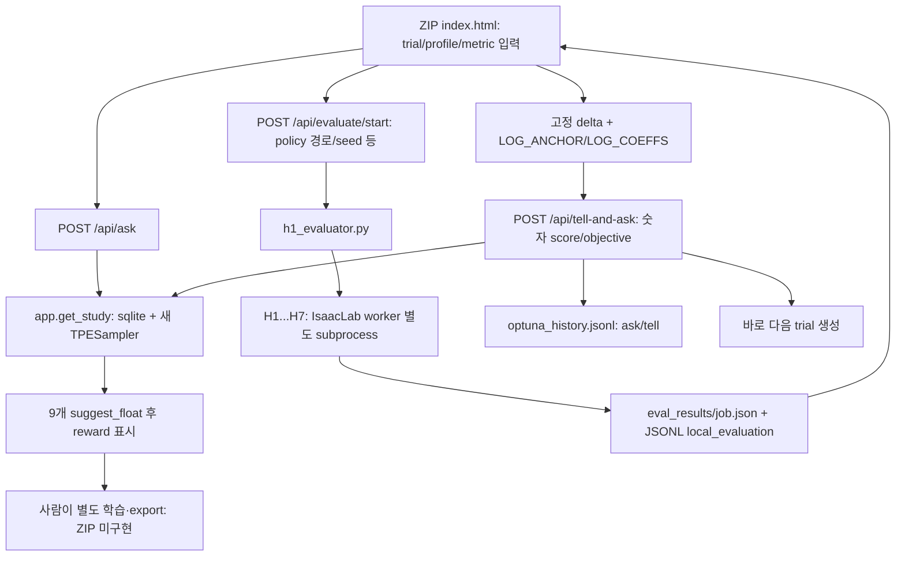

> 공개용 파생 사본 · 2026-10-23. 출처: `naver-issacsim/data/processed/incoming/other/reviewed/NCRC_H1_review_report_and_cpu_evidence_20261015/REVIEW_REPORT_ko.md` (`7f27a5e3ee9d`). 당시의 분석·PLANNED/HOLD 등 상태와 Run ID·SHA는 역사적 기록이다. 이 문서는 현재 채택 권고나 공식 평가기 명세가 아니다. 로컬 링크·개인 경로·제3자 인용은 공개 범위에 맞춰 정리했으며 원본은 별도 보존한다.

# NCRC H1 End-to-End ZIP 정적·CPU 검토 보고서

- **검토일:** 2026-10-15 (KST)
- **검토 대상:** 업로드된 `ncrc_h1_end_to_end.zip` 전체 코드·문서 및 별도 첨부 `ncrc_local_calibrator_ui.html`
- **판정:** **수정 후 제한 사용**. 현행 Windows PERSONAL 평가기는 유지하고, 저장된 결과를 검증·승인한 뒤 **개인 PC의 Ask-and-Tell**에 연결한다. ZIP의 자체 evaluator·자동평가→tell 결합과 공식점수 유사 보정은 현재 프로젝트의 기본 평가·최적화 경로로 채택하지 않는다.
- **검증 범위:** ZIP 내용 전부 읽고 주요 함수·문서 대조; Optuna **4.8.0**과 Node 22의 별도 CPU-only 환경에서 제한 재현. **Isaac Sim/Isaac Lab/실제 policy/학습/영상/export/GPU/공식 서버는 실행·접속하지 않았다.** 원본 ZIP/HTML은 수정하지 않았다.
- **입력 ZIP SHA-256:** `2704cb2b4ae3c072e302b432bafe3f342994caedf971a5e70f3562e5e9e67187`.
- **별도 HTML SHA-256:** `7f5b67cdafdde34dda754c87e6943f4efe7a01e8ae8939a1d88cc4fd879e5a0d`.

> **출처·판정 표기:** `[코드확인]` = 실제 ZIP의 코드/정적 데이터, `[CPU재현]` = 별도 임시 SQLite/가상 값·로컬 루프백 테스트, `[논리 반례]` = 주어진 코드에서 도출되는 위험·계산, `[미검증]` = 실행 환경이나 실제 증거가 없어 결론 불가. CPU 임시 trial, 재현용 점수와 가상 ZIP은 모두 **실제 H1 실험 데이터가 아니다.**

## 1. 핵심 판단과 지금 쓸 수 있는 범위

**유지:** 개인 PC에서의 Optuna `ask()`/`tell()` 방식, SQLite study, JSONL history(보조 감사 기록), per-scenario 가중 집계 함수, raw score·보정값의 명시적 구분이라는 UI 표현. 단, 중복 후보·trial identity·오류 복구를 막는 최소 수정이 선행돼야 한다.

**분리·보류:** 현재 프로젝트의 Windows PERSONAL H1 평가기 대신 ZIP evaluator를 사용하지 않는다. 이미 확보한 `native checkpoint → 6지형 MP4 → 별도 camera-off scenario7(128 env × seed4201/4202/4203 × 8 case × 20초) → manifest/diagnostics/episodes.jsonl 통합 ZIP`을 입력 데이터의 출발점으로 유지한다. 새 evaluator는 `TorchScript policy.pt`, `H1~H7` 별도 7 프로세스, 기본 각 `10 env × 20초`, 별도 seed(`base+1..7`)이므로 **명칭·시간이 비슷해도 기존 평가기와 동일하지 않다.** 기존 평가기 소스가 없으므로 metrics·관측·명령·terrain·환경의 정확한 호환성은 미확인이다.

**지금 가능한 일:** (1) 저장된 평가 ZIP의 실제 파일/필드/실험 식별자 감사, (2) 동일 프로토콜·policy SHA·checkpoint/parent·학습량·seed·case로 비교 가능한 자료 묶기, (3) survival, tracking, 실제 진행, 정지 누수, rough 하위 꼬리를 **개별 지표**로 비교하고 가설 우선순위 정하기, (4) 필요한 승인 후 개인 PC에서 단순 후보 `ask`, 공식 경로에서 **참가자가** active reward의 숫자 weight만 변경해 학습·resume·export, 결과를 개인 PC로 반입해 `tell`. 아직 유효한 관측이 없다면 Optuna 제안은 **랜덤 초기 후보일 뿐 데이터로 학습된 최적 추천이 아니다.**

**금지/제외:** OFFICIAL 서버에 Optuna 설치·연결, 도구에 의한 자동 reward 수정·학습/종료, 비활성 reward 활성화, task/PPO 수정, 새로운 공식 점수 예측 회귀식, 임의 HOLD 점수 부여는 제안하지 않는다. PERSONAL에서의 로컬 평가 동작과 OFFICIAL 절차를 분리한다.

## 2. 실제 구성, 코드 경로 및 구현 여부

| 파일(모두 ZIP 루트 기준) | 확인된 역할 | 구현 상태/제약 |
|---|---|---|
| `README.md:1-180` | 실행 방법·anchor·protocol·탐색 구간 소개 | 문서. 평가 성공 증빙 없음; `:165-180`의 3~5쌍 재보정은 방법론적 제안이지 검증된 표본 요건이 아님 |
| `requirements.txt:1` | `optuna>=4.0,<5` | 설치 필요 목록. 검사 환경 설치 Optuna 4.8.0, 실제 대상 머신 버전은 모름 |
| `app.py:25-54,78-129` | DB 경로, 9차원 reward, study/ask/summary | 구현. SQLite `ncrc_optuna.db`, history `optuna_history.jsonl`은 ZIP에 **없음** |
| `app.py:190-284,287-429` | 비동기 job·HTTP GET/POST·history | 구현. 결과 JSON `eval_results/<job>.json`; 메모리 job 상태/비원자적 전이 |
| `index.html:676-777,784-1022,1070-1245` | 보정·로그 보정·계산·UI→API | 구현. 독립적인 브라우저 계산; 서버가 원데이터/identity 검증하지 않음 |
| `evaluator/h1_evaluator.py:20-24,55-98,101-179` | 7개 워커 순차 실행과 가중 집계 | 구현. Isaac launcher를 호출해야 실제 evaluator 시험 가능 |
| `evaluator/h1_eval_worker.py:28-51,65-345` | 환경 재구성, TorchScript inference, metric | 구현 의도 확인. 실제 task·policy·환경 로딩 **미검증** |
| `evaluator/scenario_protocol.json:1-12` | 스코어/지형/명령 선언 | **설명용 정적 JSON**. `.py`에서 읽거나 버전·해시로 검증하는 코드 없음 |
| `evaluator/SOURCE_NOTES.md:1-15` | Isaac Lab commit, task/reward 가정 | 가정만 기록. 현재 checkout·NCRC task 일치 증빙 없음 |
| `start.sh:3-10`, `start.bat:2-11` | 의존성 설치 시도 및 UI 서버 실행 | 구현. `start.sh`는 `0.0.0.0` 바인딩(`:10`), 본 검토에서 실행 안 함 |
| `run_evaluator.sh:3-14`, `.bat:2-12` | 수동 평가 CLI 래퍼 | 구현. 본 검토에서 실행 안 함 |
| `eval_results/` | 평가 출력 예정 | ZIP에는 **빈 디렉터리**, 실제 평가 결과 없음 |
| 별도 `ncrc_local_calibrator_ui.html:443-727` | 단독 브라우저 고정 A/B 보정 UI | 서버·SQLite·Optuna 호출 없음. ZIP `index.html`과 **프로필·기능 다름** |

### 실제 흐름



- `index.html:784-801`은 localhost API에 fetch한다. `:906-944`가 evaluator 완료 시 입력 폼을 채우고, `:992-1022`가 그 **현재 UI 값**을 `tell-and-ask`로 보낸다. `app.py:377-423`은 `RUNNING` 여부를 확인해 `study.tell`하고 즉시 다음 `study.ask` 한다. history는 사후 append다. `app.py:190-228`의 evaluator history도 학습 Run 정보가 아닌 평가 경로·scores·aggregate뿐이다.
- `app.py:78-87`의 `create_study(load_if_exists=True, storage=sqlite:///...)`로 study 메타데이터와 완료 trial은 DB에 지속된다. **샘플러의 진행 RNG 상태까지 지속된다는 뜻은 아니다.** `app.py:108-129`의 best는 `COMPLETE` 중 현재 objective 최대값일 뿐 공식 best가 아니다.
- Optuna는 reward 후보 수치를 생성하지만 **training을 호출하지 않는다**. 제공된 파일에는 active reward 검증, 공식 서버 preflight, checkpoint provenance, export 검증, 외부 평가 ZIP import, Optuna `FAIL` 처리 API, 공식 점수 검증 파일이 없다.
- UI의 CLI helper `index.html:1205-1208` 및 별도 HTML `:615-618`은 `ncrc_optuna_calibrator.py tell ...` 명령을 출력하지만 **해당 스크립트는 ZIP에 존재하지 않는다.** 실행 가능한 fallback으로 간주할 수 없다.

## 3. Optuna 정확성 검토

**생성·로드:** `app.py:69-87`의 stage별 `ncrc_h1__<safe_stage>` 이름과 DB 저장·기존 study 재사용은 실제 구현. `study.tell(trial_no, objective)`는 정상적인 Optuna Ask-and-Tell 용법이며 duplicate tell에 대한 순차 검사(`:390-400`)도 존재한다. 단, 서로 다른 비교 조건을 **study와 함께 잠그지 않는다**(프로필·evaluator 버전·policy hash·training budget·seed·parent 등 미검증).

**반복 샘플:** `app.py:78-80`은 API **요청마다** `TPESampler(seed=20260922, n_startup_trials=8, multivariate=True)`를 새로 만든다. CPU 실측 Optuna 4.8.0의 별도 SQLite에서 호출 3번이 **trial #0/#1/#2에 동일한 9개 값을 줬다**(`optuna_cpu_results.json:reinitialized_sampler`). 같은 sampler 인스턴스를 유지한 반례에서는 첫/둘째 후보가 달랐다. 이 현상은 Optuna가 중복을 반드시 막지 않는다는 일반론을 넘는 **현 코드의 재현된 결함**이다. 초기 8개의 완료 trial도 수가 충분하다는 뜻일 뿐 **8개 서로 다른 정책** 또는 8개 독립 학습을 뜻하지 않는다. 시험에서는 **가상 COMPLETE 8건 모두 같은 reward 벡터**를 가졌고, #8은 다른 벡터였다(결과 파일 `eight_completed_startup_synthetic`). 가상 objective는 성능 증거가 아니다.

**스타트업/학습:** Optuna 문서상 `n_startup_trials` 완료 수 전에는 random sampling이며, multivariate TPE는 데이터가 쌓여야 과거 objective를 이용한다. 이 ZIP에는 기존 DB·trial·평가 결과·실험당 policy identity가 없으므로 기본 stage가 과거 누적 실험에서 학습됐다는 증거가 **0개**다. 숫자 보정 상수는 Optuna의 관측값이 아니다. 데이터 없이 ‘추천’이라 말할 수 있는 것은 **범위에 맞춘 후보 생성**이며 성능 방향성 추천은 불가하다. 재시작·여러 브라우저 요청에서 샘플러 재생성/동시성 경계도 명시해야 한다.

**search space:** `app.py:44-54`, `:90-95`는 9개 **연속 실수, 기본 선형(uniform) `suggest_float`**, `step`/`log` 없음. 현행 `action_rate_l2`는 `[-0.0080, -0.0002]`이므로 실제 핵심 후보 **`-0.0001`을 포함하지 않는다**. 주석(`:91`)의 ‘supplied run history’는 ZIP 안의 Run data로 입증되지 않는다. `termination_penalty=-300..-40` 등 넓은 범위도 현재 활성·허용 reward와 개인 실험 분포가 합치하는지 별도 확인 필요하다. `search_space.csv`에 전체 구간 수록.

**stage 분리:** `app.py:61-70`은 공백/특수문자 제거 후 96자 절단하여 충돌 가능. CPU 확인 `"alpha a"`와 `"alphaa"` 모두 `ncrc_h1__alphaa`. `index.html:836-842`는 해당 study의 **마지막 RUNNING**을 폼의 trial로 표시한다. 조건이 바뀌거나 RUNNING이 여럿이면 적정 trial을 보장하지 않는다. 다른 search space·실험 계보·objective·프로토콜은 study를 분리하고 동일 stage에서는 freeze해야 한다. 이름만 다르게 하면 조건이 같다는 보장도 없다.

**실패·중복·부분 실패:** `app.py:395-397`에서 완료 trial의 순차 duplicate tell을 거절하는 것은 장점(CPU HTTP 시험: 첫 tell 200, 중복 400). 그러나 `app.py:354-428`에 실패 trial을 `FAIL`로 전이시키는 경로가 없고, 학습/평가가 실패해도 `RUNNING`이 남는다. `study.tell` 직후 history append, 이어 next ask, append, response 순서(`:399-423`)가 DB/history/화면 전체에 대한 하나의 트랜잭션은 아니다. CPU에서 **DB tell 성공 직후 이탈**을 합성하자 `COMPLETE`만 남고 tell history 0건이었다(실제 crash 재현 아님). HTTP 응답 유실 후 재시도 시 duplicate 거절이 발생해 사용자가 결과 반영 여부를 확인해야 한다. 중복 검사와 tell의 원자성도 직접 보장하지 않는다.

**설치 버전 경계:** 본 CPU의 Optuna 4.8.0, Python 3.13.5 외 실제 개인 PC 버전은 미확인. 다른 4.x 세부 순서/동시성 동작이 동일하다고 단정하지 않는다. 공식 Optuna 문서 링크는 §10 참조.

## 4. 점수, 보정, 수치 반례

### 4.1 TERM50 56.37 anchor는 ‘산술 적합’, 평가 검증은 아님

`index.html:686-700`은 `term50_official_anchor_5637` 프로필에 `perScenarioDeltaNorm`을 하드코딩하고 `:749-757`에 B 예시값을 하드코딩한다. CPU로 **ZIP 코드에서 직접 추출한 JS 상수/산식**을 계산한 결과:

| 구성 | /70 | 의미 |
|---|---:|---|
| B 예시 raw = Σ(local × 각 배점) | **50.1193** | `H1..H7` 예시 입력의 가중합 |
| TERM50 고정 delta 합 | **+6.2507** | per-scenario delta×배점의 합; 예시에서는 clipping 없음 |
| TERM50 base calibrated proxy | **56.3700** | 표기된 anchor 56.37과 **정확히 맞게 구성됨** |
| anchor와 로그 값이 동일한 경우 | **56.3700** | `LOG_ANCHOR` 차이가 0 |
| Optuna objective | **0.805285714...** | final/70 |

코드에서 **역산 가능한** anchor의 H1..H7 점수는 `8.62, 11.24, 5.73, 5.66, 8.17, 8.47, 8.48`점(합 56.37)이다. **이 값이 실제 공식 세부 점수 원문에 적힌 것인지 입증하는 독립 데이터·공식 PDF·정책 SHA·동일 evaluator 결과는 ZIP에 없다.** 이 값은 `term50_anchor_inferred.csv`에서 ‘UI 상수로부터 도출’이라고 구분했다. README `:7-10`의 공식 1 anchor라는 설명과 코드의 상수·총합은 일관되지만, B_EXAMPLE이 **새 worker를 실행한 실제 결과인지**, 동일 정책인지, 공식 점수와 같은 episode/조건인지 **미검증**이다. 이를 누적 Optuna 관측 또는 공식 절대점수의 외부 검증으로 바꾸어 말하면 안 된다.

### 4.2 raw / base / log-adjusted / objective

공식이 아닌 **local proxy**의 코드상 관계(`index.html:1092-1119`, `:1131-1174`):

```text
raw70     = Σ_i w_i * clamp(local_i, 0, 1)
base70    = Σ_i w_i * clamp(local_i + fixed_delta_i, 0, 1)
logDelta_i = clamp(c_fall_i*(fallPct - 28.93)/100
               + c_terrain_i*(terrain - 5.825)
               + c_xy_i*(xyError - 0.378)
               + c_yaw_i*(yawError - 0.935)
               - min(0.01, max(0, std-2.0)*0.01), -0.05, +0.05)
final70   = Σ_i w_i * clamp(clamp(local_i + fixed_delta_i,0,1)
                           + logDelta_i, 0, 1)
objective = final70 / 70
w_i       = (10.5,14,7,7,10.5,10.5,10.5)  [Σ=70]
```

위 식의 std 항은 `explorationStd`가 없거나 2 이하일 때 0. fall은 **percentage point를 100으로 나눠 0..1 차이로** 처리, XY RMSE는 m/s, yaw RMSE는 rad/s, terrain level은 임의의 훈련 curriculum 척도다. 로그 계수는 각각 이 이질적 단위를 곱한 **수동 heuristic**으로, ZIP에 회귀 fit·검증 코드·불확실성 추정이 없다. H1 실패 38건의 중앙값·상관관계(`index.html:460-465`) 역시 **기초 38행이 없음**. `LOG_ANCHOR` 값(`:760-765`)과 `LOG_COEFFS`(`:769-777`)의 원천/실험조건도 추적 불가. `LOG_ANCHOR`는 std가 없고 2 이상 std penalty는 별도 규칙이다.

**표시 불일치(CPU):** 다른 세 보정 프로필의 `globalDelta70` 설명과 실제 per-scenario 합은 일치하지 않는다.

| profile | 표시 `globalDelta70` | B 예시 실제 base−raw | 차이(표시−실제) |
|---|---:|---:|---:|
| TERM50 official | +6.2507 | +6.2507 | 0 |
| `ab_mean_20260921` | +6.9000 | +6.3966 | +0.5034 |
| `b_exact_20260921` | +6.3800 | +6.3966 | −0.0166 |
| `ref_mean_20260921` | −0.3250 | −0.1764 | −0.1486 |

또한 `ab_mean`과 `b_exact`는 **동일한 per-scenario delta**(`index.html:707-729`)를 사용하므로 **계산값은 같고** 단지 보이는 `band/globalDelta`만 다르다. `index.html:1180-1203`의 ‘경험적 범위’도 `raw + profile.band ± log 조정`이고, 실제 `clamp`를 통과한 base 계산의 범위·확률적 신뢰구간은 아니다. 단일 official anchor로는 오차 분포나 의미 있는 band를 추정할 수 없다. 별도 HTML은 `ab_mean`이 기본이며 TERM50 official 프로필과 LOG 보정 자체가 없음(`ncrc_local_calibrator_ui.html:453-508,562-639`); 두 화면을 같은 계산기로 혼동하면 안 된다.

**빈 입력(CPU):** `index.html:1057-1060`에서 미입력/NaN을 0으로 처리하고 `:1131-1145`에서 델타를 더하므로 **7개 점수가 모두 비어 있어도 TERM50 final/base = 6.2507/70**(로그 OFF)이다. `:992-1013`의 tell 검사는 점수가 finite인지뿐이므로 자료 없는 숫자를 실제 trial objective로 보낼 수 있다. 음수/1 초과 입력도 검증 오류 대신 silent clamp. UI에 `min/max` 속성만 있고 계산과 수동 API에는 출처 확인이 없다. CSV loader(`:1309-1323`)는 부분/잘못된 행을 누락해 자동 0으로 떨어뜨린다.

**순위 보존 조건과 반례(CPU):** 모든 후보가 같은 fixed delta/profile이며 시나리오별 `local_i + delta_i`가 모두 0..1 **내부**에 있고 LOG 항목은 완전히 꺼진 경우 `base70 = raw70 + 같은 상수`라 순위가 **변하지 않는다**. 하지만 clipping 또는 후보별 log가 다르면 달라진다.

- **fixed delta만의 역전(실제 UI 산식, 합성값):** A의 `H5=.88, H2=.22`, 나머지 .50; B는 7개 모두 .50. raw A **35.07** > B **35.00**이지만 TERM50 base A **41.1202** < B **41.2507**. 원인: A의 H5가 1로 상단 clipping되며 고정 delta의 유효 가산폭이 감소. 이는 고정 delta를 씌우면 반드시 모든 후보 순위가 보존된다는 주장에 대한 반례이지 실제 성능 데이터가 아니다.
- **log만의 역전(실제 UI 산식, 합성값):** A의 local 모두 .81, fall 35.00%; B는 모두 .80, fall 28.93%; 다른 log 값은 anchor. raw A **56.70** > B **56.00**, 최종 A **60.99616** < B **62.25070**. LOG 항목 선택이 순위를 바꾼 것이다. 시나리오별 최대 ±.05라 총 `70×.05=3.5점`까지 하나의 log layer가 바꿀 수 있으나, 최종 clipping으로 실제 영향은 달라진다.

**이중 반영·지표 혼종:** 새 worker의 `score_i = survival_rate × tracking_proxy`(`h1_eval_worker.py:300-304`). 총 weighted fall은 바로 **동일 cohort의** `1−survival`로 계산(`h1_evaluator.py:80-98`)되고 UI가 이를 `fallRatePct`에 자동 입력(`index.html:861-875`), 다시 `LOG_COEFFS.fall`을 최종 점수에서 벌점으로 반영하므로 **동일 낙상 현상의 중복 페널티**다. XY/yaw tracking RMSE도 이미 kernel 점수 계산에 사용한 error의 함수이므로 추가 반영 시 tracking을 중복 반영할 가능성이 있다. 반면 training curriculum terrain level·exploration std는 학습 중 확률적·시점 의존 지표로 deterministic fixed evaluation의 분모/환경과 다르다. 서로 다른 분포·checkpoint·seed·학습 길이에서 가져온 training 지표를 하나의 TERM50 anchor에 섞는 것은 정당화되지 않는다. **추천:** 로그 항목은 score에 섞지 말고 **별도 진단 열**로 유지. 공식 점수의 절대값 예측과 같은 효과를 주장하지 않는다.

**서버 objective 불일치 허용(CPU):** `app.py:380-388`은 `score_70 ∈ [0,70]`, `objective ∈ [0,1]`만 각각 확인하고 서로의 비율이 맞는지 확인하지 않는다. 로컬 HTTP 시험에서 **score_70=10, objective=1.0**을 보내자 trial objective가 **1.0**으로 DB에 저장됐다. 원래 `10/70≈0.142857`이어야 한다. `index.html:1213-1217`에서는 score가 **소수 2자리**로 JSON payload에 들어가고 objective는 6자리이므로 아주 작은 오차도 원래부터 가능하다. server는 **하나의 값만 기준으로 유도**하거나 허용 오차를 정의해야 한다.

## 5. evaluator 기술 검토: 확인된 구현과 runtime 한계

| 항목 | 코드 근거와 관찰 | 판정/필요 확인 |
|---|---|---|
| 입력 정책 | `h1_eval_worker.py:11,233-235` `torch.jit.load(...,map_location=device)` + `.eval()`; 입력은 `_policy_obs(obs)`를 그대로 전달(`:194-197,258-283`) | **exported TorchScript용**, native checkpoint `.pt`는 직접 사용 대상 아님. 256차원은 주석일 뿐 shape/assert/normalizer 스키마 검증 없음. 기존 evaluator/export와 호환 **미검증** |
| task/관측 | `:222-236` `h1_task`, `HumanoidRoughEnvCfg`, `gym.make("Humanoid-v0",cfg=cfg)`. policy observation corruption OFF `:116-117`; command 덮어쓴 뒤 `observation_manager.compute(update_history=False)` `:253-259` | 맞는 Isaac Lab commit/task checkout인지, reset·history/observation ordering, training obs normalization과 height scan/action scale 일치 여부 **미검증**. `SOURCE_NOTES.md:6-7`의 `H1RoughEnvCfg` 설명과 실제 import `HumanoidRoughEnvCfg` 관계도 외부 task 소스로 확인 필요. corruption OFF가 전체 randomization OFF를 뜻하지 않음 |
| flat/rough | `:65-85` plane/ROUGH_TERRAINS_CFG의 random_rough noise_range=.02-.04; terrain curriculum OFF `:80,128-141` | 텍스트/JSON 설명과 구현 의도 일치. 실제 높이·spawn 배정·reward observation 유지 여부 확인 필요 |
| slope ±8–10° | `:87-109` `hf_pyramid_slope` 및 `_inv` 각각 proportion=.5, `slope_range=(tan8°,tan10°)` | slope 인자를 rise/run으로 가정(주석 `:91`); 상·하 **실제 env 수/trajectory 균형 미검증**. 결과는 H6 통합 한 값뿐, sign·지형별 꼬리 데이터 없음 |
| 명령 | `:119-126` 기존 command 범위를 0, 리샘플 범위 1e9; `:153-191` 수동 time schedule; 루프 `:250-259`에서 command view를 직접 덮어씀 | protocol 문자열과 큰 틀 일치. 실제 `get_command()` view 가변성/manager의 step 전후 갱신은 실제 env로 검증 필요 |
| H7 push | `:143-150` interval 4초, x/y 각각 균등 범위 `(-v,v)`, velocity-setting event | **매번 정확히 ±0.5m/s 단일 크기**가 아님. 각 축 random sample. 실제 발생 시각·벡터·전후 회복 로그 없음 |
| termination/done | `:236-246` 첫 reset env cohort alive mask, `:271-287` **terminated만** 처음 낙상 처리, 이후 mask 제외 | 첫 cohort 중심 설계는 장점. fallen env가 reset돼도 통계 분자에서 제외. 다만 **truncated는 무시**되며 자동 reset이 발생한다면 다른 episode 생존을 첫 cohort로 오인 가능(`:283-290`). `episode_length_s=duration+2`로 보통 회피 의도; 실제 문제 발생은 미검증 |
| time/분모 | `:248-249` `round(duration/dt)` steps; `:271-304` 살아 있던 기간만 누적, **각 env의 유효 step 평균을 먼저 낸 후 env 평균**, 최종 survival=마지막 alive fraction | `episodes=10`은 env 수이지 시간에 걸쳐 10회 반복한 독립 에피소드가 아님. 낙상 env도 사망 전 tracking 평균은 남아 최종 `survival×tracking`에 포함. 길이 가중 pooled tracking과 결과 다름 |
| tracking/units | `:262-270` world linear velocity→yaw frame, XY error 제곱합, world yaw rate error; `exp(-error²/0.5²)`; `:293-304` RMSE·kernel. H1(.65/.35), H4(.25/.75), 기타(.85/.15) | reward 유사 kernel은 **근거 있는 설계 선택**이나 official hidden tracking이 같다는 증거 없음. `xy_rmse` m/s, `yaw_rmse` rad/s, tilt projected gravity RMS는 무차원 크기 지표이지 각도(deg) RMS 아님 |
| 실패 후 추종 | `:271-287` m=alive, 실패 후 kernel/오차 집계에서 제외 | reset 뒤 트래킹이 섞이지 않도록 의도적으로 방지. 그러나 통계적으로 조기 낙상자와 생존자를 동일 env 가중으로 섞고 survival를 다시 곱하므로 tracking 해석에 주의 |
| 종료/timeout | `:114` duration+2, `:283-290` `truncated`는 사용 안 함. `h1_evaluator.py:70-75`, `app.py:207-215` subprocess timeout 없음 | task의 외부 조기 timeout, 워커 hang, launcher 문제에 대한 종료·복구 경로 없음. Isaac 실제 재현 미실시 |
| 총점/진단 | `h1_evaluator.py:20-24,79-98,132-150` fixed weights 합 1, raw/70, weighted fall, H2/H3/H5/H6/H7의 weighted **개별 RMSE 평균**, yaw=H4만 | 7개 스코어 가중합은 CPU 가짜 fixture로 0.5→35/70 검증. XY aggregate는 **pooled square-error RMSE가 아님**. 진행 거리·정지 누수·rough tail 부재 |
| protocol 파일 | `scenario_protocol.json:1-12` vs `worker.py:111-207` | 주요 score/mix/terrain/명령 수치가 부합. 다만 JSON을 코드가 읽지 않고 checksum/실행 protocol version 잠금도 없어 수동 drift 가능 |

**추가 해석:** Worker의 `H3` 20초 스케줄에서 +vy .25는 2–6초와 18–20초로 **6초**, 다른 ±0.25/±0.5 각 **4초**다. `H4` yaw +0.5는 20초 말미에 또 2초 나타난다. 해당 시간 가중을 계산에 명시하거나 목표에 맞춰 프로토콜을 변경해야 하며, duration을 UI에서 바꾸면 case 분포도 바뀐다(`h1_eval_worker.py:168-184`, `test_worker_pure_cpu.py`). 대칭 command 비교를 암묵적으로 전제해서는 안 된다.

**평가기 품질의 목적 부합 여부:** `survival×kernel`은 낙상/속도/회전 스크리닝에 쓸 수 있는 간명한 지표다. **실제 목적지/terrain 진행, stopping segment의 정지 누수, 방향별 slope 통과, rough worst-case**를 측정하지 않아 이 항목이 목표인 기존 프로젝트의 단독 objective로는 부적합하다. 10-env 단일 시드만으로 하위 꼬리·신뢰도를 판단하기도 어렵다. README의 "동일 프로토콜 A/B 비교"라는 제한적 의도는 합리적이나, 기존 evaluator와 교체 가능한지/실제 동작하는지는 **미검증**이다.

## 6. 문제 목록: 심각도·근거·반례·영향·최소 조치

**심각도:** P0 = 현재 평가→학습 의사결정 연결을 막아야 함; P1 = 제한 사용 전 필수 해결; P2 = 프로토콜 고정/진단/운영상 주의. 상태는 `[CPU재현]`, `[코드확인/논리 반례]`, `[미검증 잠재 위험]`을 구분한다.

| ID/심각도·확인 수준 | 정확한 위치 | 재현 입력/논리적 반례 → 영향 | 최소 수정 방향 |
|---|---|---|---|
| **I01 P0 [코드확인/논리 반례] trial↔policy 분리** | `index.html:906-938,992-1013`, `app.py:234-272,377-407` | A trial 표시 중 `policy.pt`가 B의 export여도 경로만 평가하고 현재 폼 trial A에 score 전송. long eval 중 stage/trial/reward/profile 변경도 가능 → **오탐 학습 신호** | ask 시 trial+active weight/config/parent/budget 고정; 평가 결과에 policy SHA·protocol hash와 trial 매핑, tell 시 사용자 확인 후 일치 검증. 유효한 저장 ZIP만 tell |
| **I02 P0 [CPU재현] 반복 sampler 초기화** | `app.py:78-95` | 동일 study에 매 request `TPESampler(seed=...)` 생성 → CPU에서 trial #0/#1/#2 파라미터 9개 전부 동일 → 비교 예산 낭비·편향 | sampler 인스턴스 유지 또는 재시작 상태/난수 재현 전략 수정; CPU 회귀 테스트와 중복 후보 감지/의도한 replicate 분리 |
| **I03 P1 [CPU재현] objective/score 무결성** | `app.py:380-388,399-406`; `index.html:1213-1217` | `score_70=10, objective=1` HTTP 200 후 1.0 저장 → best 조작/오집계(실수로도 발생) | 요청 시 canonical `score_70`에서 objective 계산, 점검 후 append; 원본 raw 진단 별도 보존 |
| **I04 P1 [코드확인] action rate 범위 누락** | `app.py:44-54,90-95`, `README.md:149-159` | `action_rate_l2=-0.0001`이 상한 `-0.0002` 밖 → 핵심 후보에 도달 불가 | 공식에서 활성화·허용된 reward **숫자 weight**만 확인한 후 새 좁은 search space에 포함; 다른 조건을 바꾸면 새 stage/study |
| **I05 P1 [코드확인/논리 반례] failure·부분 commit** | `app.py:282-284,354-428`; `:190-231` | job 실패→Optuna RUNNING 영구 잔류; `tell→history→ask→history` 사이 이탈 시 DB/JSONL/UI 불일치; CPU 합성 `COMPLETE`/tell history 0 | 실패/abandon 명시, 재시작 reconcile DB-first, tell/next ask 분리, history idempotent 저장 및 반환 상태 확인 |
| **I06 P1 [코드확인/논리 반례] 평가 job 생명주기** | `app.py:31-33,190-231,259-281`; `index.html:906-921` | EVAL_JOBS는 메모리만 유지; 재시작 상태 404, 부주의한 두 브라우저의 동시 평가 허용. 하위 subprocess에 wall timeout/취소 미구현 | 개인 PC에서 평가 외부 유지(권장). 사용한다면 직렬화, timeout, 완료 파일 검증, restart recovery |
| **I07 P1 [코드확인] anchor 데이터 provenance 결여** | `index.html:686-777,460-465`, `README.md:7-10` | 공식 56.37은 하드코딩 예시에서만 맞춤; 공식 각 점수 원문/동일 policy SHA/새 evaluator 결과/38 실패 원자료 없음 → 외삽 근거 부족 | 수동 고정 보정은 참고 표로만 두고 official breakdown과 동일 policy 평가를 확보할 때까지 objective에서 제외 |
| **I08 P1 [CPU재현] clipping·빈 입력** | `index.html:1057-1059,1131-1174,1180-1203`, `:992-1013` | 7개 빈 입력=6.2507/70; 35.07 > 35 raw 후보가 base 41.1202 < 41.2507로 뒤집힘. 임의 `band`도 실제 계산과 불일치 | 7개 유효성과 metric 조건 확인 전 tell 차단; raw/raw diagnostics를 기본으로, 선택적 보정은 배경 수치로 따로 표시 |
| **I09 P1 [CPU재현 + 코드확인] LOG 이중 반영·혼종** | `index.html:861-875,1092-1119`; `h1_eval_worker.py:300-304`; `h1_evaluator.py:80-98` | survival과 동일 fall이 kernel score와 log correction에서 중복; XY/yaw error도 kernel과 중복. synthetic rank inversion 재현; training terrain vs deterministic eval 혼합 | LOG 계수 objective에서 떼고 provenance 있는 독립 진단, 같은 anchor/metric 산식 아니면 사용 금지 |
| **I10 P1 [미검증 잠재 위험] TorchScript/obs/task 불일치** | `h1_eval_worker.py:11,222-235,253-283`; `SOURCE_NOTES.md:3-15` | native `.pt`를 export 없이 제공, obs 256/normalizer가 다름, H1 task 인터페이스가 달라 실패/틀린 행동 가능(실제 실행 안 함) | 기존 PERSONAL evaluator 우선. 별도 채택 시 정확한 checkout/task/env/config/obs/normalizer/액션 및 policy SHA CPU preflight→허용된 개인 GPU smoke |
| **I11 P1 [코드확인] 실진행·rough tail 미수집** | `h1_eval_worker.py:240-304,312-345`; `h1_evaluator.py:79-98` | kernel이 높아도 제자리 진동/오르막/정지 실패는 직접 검출하지 못함; H6 상/하 하나로 병합 | 기존 `episodes.jsonl`에서 실제 거리/terrain/pass/fail/stop leakage/rough 하위 분위수를 별도로 보존·판정 |
| **I12 P2 [논리적 잠재 위험] timeout/truncated** | `h1_eval_worker.py:114,236-249,283-304` | horizon 전 `truncated=True`인데 `terminated=False`면 alive 유지; auto reset의 후속 episode를 첫 cohort로 잘못 집계 가능. 통상 duration+2로 완화 의도 | terminated/truncated/첫 episode 완료 시점을 따로 기록; early truncation 분모 처리. 개인 실환경 검증 전엔 가정으로만 표시 |
| **I13 P1 [코드확인/CPU재현] stage drift** | `app.py:61-70,78-87,361-375,377-406`; `index.html:836-842` | 서로 다른 문자열 stage collision 재현; 같은 stage 안에 다른 프로토콜·학습량/seed·reward search가 섞여도 tell됨 | stage config+protocol fingerprint immutable, 조건 바뀔 때 새 study, 입력 identity 조건 검증 |
| **I14 P2 [코드확인] CLI fallback 가짜** | `index.html:1205-1208`, 별도 HTML `:615-618`; ZIP file 목록 | UI 출력 명령의 `ncrc_optuna_calibrator.py` 없음 → 복사 실행 실패 | 실제 존재하는 PC용 CLI/API만 표시하거나 비활성/제거 |
| **I15 P2 [코드확인] 결과 누락 시 stale 입력** | `index.html:861-875,1057-1059,1309-1323` | 결과에 H7 빠지면 이전 H7 입력값 유지; CSV 누락은 0으로 계산 → policy 혼합/침묵 입력 오염 | 결과 적용 전에 7개 완전성·범위·policy/metric 단위 확인, 이전 값 자동 clear, validation gate |
| **I16 P2 [코드확인] command/terrain 비교 제약** | `h1_eval_worker.py:87-108,153-191`, `scenario_protocol.json:5-11` | H3 ±vy 노출 시간 비대칭, H6 slope sign별 cohort/진행 부재, H7 실제 push magnitude 미기록 | 고정된 비교 protocol version 기록, 명령 구간/상하/충격별 요약; 현 결과는 제한적 screen |
| **I17 P2 [코드확인] 래퍼 timeout/원인 분석** | `h1_evaluator.py:55-76,124-178`; `app.py:207-220` | worker별 subprocess timeout 없음, 기본 임시 개별 결과는 마지막에 제거; 장애 후 H1~H6 근거 보존 부족 | 실패 첫 원인 로그·부분 결과·실제 launcher/config 기록, timeout/실패 status; 사용 전 개인 환경 검증 |
| **I18 P2 [코드확인] UI·설치 범위** | `start.sh:4-10`, `index.html:686-777`; 별도 HTML `:453-496` | Linux UI가 `0.0.0.0`로 시작하고 두 HTML 기본 프로필/기능 불일치 → PC 이외 노출·보정 혼란 | 개인 PC `127.0.0.1` 기본, standalone 화면과 ZIP 버전·보정 정의 명시. 공식 서버 실행 경로로 사용하지 않음 |

**장점도 확인:** 트라이얼 완료 상태 확인, score/objective 각각 유한/범위 검사(`app.py:385-397`), `GET /api/health`, 진단용 `eval_results/*.json`, 계산 결과에 raw/base/final 구분, scenario 분리 subprocess, 워커의 first-cohort `alive` masking, flat/rough/slope 시나리오 분리, 공식 점수 미복제 고지가 존재한다. 다만 **제어 흐름 설계가 존재함**과 **실제 정책/환경에서 정확히 평가됨**은 다른 판단이다.

## 7. 재사용·제외·최소 수정 순서

### 두 통합 방향 비교

| 판단축 | **A. 기존 평가기 유지 + 저장 결과→개인 PC Optuna** | B. ZIP 통째로 evaluator+보정+Optuna |
|---|---|---|
| 기존 Windows PERSONAL evidence | manifest·diagnostics·episodes.jsonl·MP4·source SHA·기존 scenario7 보존; 변화 최소 | 다른 7-scenario 정의·환경/시드/정규화로 **비호환 가능**, 비교 검증 필요 |
| 재학습/GPU 비용 | 저장된 결과 재분석은 **CPU**, 새 reward 시험은 공식 절차에서만 GPU | 새 local eval 7 subprocess 추가 실행 요구(개인 GPU에서만 허용), 기존 evidence와 불일치 |
| identity·trial 연계 | SHA/Run lineage/protocol을 저장 ZIP 기반으로 붙이기 쉬움 | 현재 path만 저장, auto-eval 후 폼에 있는 trial에 tell 위험 |
| 목표 지표 | 실제 진행·정지 누수·rough tail을 기존 diagnostics에서 추출 가능한 만큼 보존 | survival×tracking kernel + 7점수가 위 실패 모드를 직접 대표하지 못함 |
| 보정/공식 점수 | 단일 anchor는 참고 sanity check | 예시와 anchor가 산술적으로 일치하나 외삽·추정 불가, 순위 역전 가능 |
| 운영 범위 | 개인 PC ask → 사람 확인 → 공식 server 기존 reward/training/export → PC tell | ZIP 자체도 서버 학습 자동화는 없으나 평가와 tell UI 자동 연결로 실수 가능 |
| 권고 | **우선 채택** | **통합 도입 보류**, 독립 스크리닝 후보로만 평가 |

**재사용 최소 단위:** `app.py`의 study 저장/ask/tell 기본 API를 개인 PC용으로 분리하여 **상태/identity/기록 검증 후** 사용, `h1_evaluator.py:79-98` 가중 집계를 별도의 CPU 진단 계산 예제로만 이용, `index.html`은 raw・metric 분리 표시 디자인 아이디어, `scenario_protocol.json`은 문서 비교 참조. `h1_eval_worker.py`는 구현을 학습하거나 독립적인 로컬 screening benchmark를 재검토할 때만 참조; 지금 기존 평가기를 교체하지 않는다.

**최소 수정 상위 5개(우선순위 순):**

1. **trial identity lock:** ask 시 trial/stage/동결 reward 구성·Run lineage/parent/checkpoint·protocol/seed/case/학습량, 실제 export policy SHA를 연결하고 **tell 전에** 표시·일치 확인. 경로 문자열만으로 policy를 식별하지 않기.
2. **Optuna seed/중복/수명:** 요청당 seeded sampler 재생성을 바로잡고, 후보 벡터 중복 검사 및 intentional replicate 구분. 같은 study의 sampler·버전·space 정책을 기록. `-0.0001` 포함한 **허용된 active reward 숫자만** 대상으로 새 study 설정.
3. **Ask/Tell 상태 안정성:** `tell`과 `ask next`를 독립적으로 승인/확인, DB 상태가 canonical; 실패/abandon, 재시작 reconciliation, 이중 응답/부분 실패 복구. 진단 JSONL은 DB와 연결되는 보조 기록으로 사용.
4. **기존 결과 adapter 최소 스키마:** 실제 개인 평가 ZIP에서 policy SHA + native checkpoint/Run/source/parent/seed, 8 case×3 seed×128 first-cohort, metric 정의/단위, evaluator/config/protocol version을 읽고 누락·섞임 확인. 새 evaluator subprocess 연결은 **제외**.
5. **objective 보정 분리:** 기본 출력은 기존 평가기의 **검증 가능한 동종 지표**(survival/tracking/progress/stop/rough tail) 분리. LOG heuristic과 단일 anchor의 pseudo-score를 Optuna에 자동 입력하지 않는다. scalar objective가 아직 검증되지 않았다면 **trial ask까지만** 하고 tell은 보류; 새로운 임의 숫자/공식 점수 예측기를 설계하지 않는다.

### 9차원 전수 탐색 vs 작은 부분공간

- 현재 기본 9개 **연속 차원**을 동시에 바꾸면, 한 trial의 성능 차이를 개별 reward 효과로 돌릴 수 없다. Optuna 기본 초기 완료 trial 8개는 **9차원 표면을 배우기에 충분하다는 보장도 없고**, 현 버그에서는 8번 동일 후보까지 나왔다. 공식 학습·평가 비용은 trial마다 실제 한 회/이상의 Run 및 evidence 확보가 필요하다. Seed 반복은 독립 학습 반복이 아니며, fresh/resume·부모·학습량·선택 checkpoint가 다른 결과를 한 objective 축에 그냥 합칠 수 없다.
- **1–3개 active weight 부분공간**으로 줄이면 동일 parent checkpoint/학습 iteration/seed/evaluator·동일 평가 조건에서 차이를 읽기 쉽고, 저장된 evidence를 먼저 비교할 수 있다. 우선 예시로 실제 후보 `action_rate_l2=-0.0001`의 인근을 포함한 **한 변수 가설**을 세우되, 사용자 승인된 reward value 범위를 확인하고 기존에 해당 비교 Run이 있는지 먼저 확인한다. 필요하면 tracking 계열 등 **가설이 바뀔 때** 별 Experiment로 나눈다. 부분공간도 효과·공식 점수 향상을 보장하지 않고 학습 대조군 없이는 인과 추론 불가다.
- Reward 변경 후 resume라면 **같은 부모에서 reward를 바꾸지 않고 같은 기간 이어 학습한 Run**을 우선 대조군으로 제안한다. fresh 변경이면 동조건 fresh baseline. 최종/대표 checkpoint는 후반 추세와 actual source를 확인하여 선정; `model_best.pt`라는 이름이나 같은 model 번호로 동일 정책이라 단정하지 않는다.

## 8. 실제 기존 결과에서 시작할 CPU 검증 순서 (새 데이터가 들어오면)

현재 입력엔 **기존 Windows PERSONAL 결과 ZIP·평가기 소스·실제 checkpoint·상세 official PDF가 없음**. 아래 1~3은 **지금 즉시** 수행 가능한 데이터 감사이며, 4~5는 자료 확보 뒤 수행한다. 이 보고서의 CPU 수치는 **기존 실제 Run에 대한 비교가 아니다**.

1. **실제 schema 탐색:** 각 통합 ZIP에 `audit_saved_eval_zip_cpu.py input.zip --output audit.json` 실행. 파일 목록, JSON top-level 필드, `episodes.jsonl` row count·field 빈도·malformed count를 검사. 코드가 metric 정의를 **추정해 재구성하지는 않는다**. 같이 받은 `manifest/diagnostics/episodes`의 실제 필드 이름 확인 후 mapping 작성.
2. **identity 결합:** `native checkpoint SHA`와 `export policy SHA`를 별개 열로, 실제 training Run ID, `PERSONAL/OFFICIAL` 출처, parent/native resume or evidence `from-run`, resolved reward value, task/checkpoint selection, 학습 iters·train seed, 평가 아카이브 identity를 연결. 동일 파일명/model 번호라고 합치지 않는다. 출처 충돌이면 해당 trial tell 보류.
3. **분모/동일 평가 조건 확인:** scenario7 **3 seeds × 8 cases × 128 env**라는 설계를 기준으로 실제 `episodes.jsonl`이 **첫 cohort와 reset episode를 어떻게 구별하는지** 확인. 기대 first cohort 단위가 seed×case×env당 1개라면 **policy당 3,072개**이지만 실제 파일 포맷/로그 대상에 따라 row 수는 다를 수 있으므로 단순 3,072행을 통과 조건으로 오용하지 않는다. duration 20s, camera OFF, terrain/command, evaluator version, 환경 수/사건 수·timeout/terminated를 서로 맞춘다.
4. **분리 지표 비교(동일 조건에서만):** seed×case 기준 fall/survival의 분산·하위 사례·표본 불확실성을 먼저 확인하되 env 간 상관·같은 training policy의 반복 seed는 **독립 학습 반복이 아님**을 보존. tracking은 fall 전/후/전체와 분모, progress는 실제 전진 거리/지형 통과, stop leakage는 zero command 구간의 residual speed, rough tail은 terrain별 worst-case/낙상/하위 분위수를 따로 계산한다. **필드가 없으면 산출 불가**로 표기하고 새 점수로 대체하지 않는다.
5. **비교 설계 검증:** 실제 저장된 동일 lineage/parent/budget/checkpoint-selector 대조군이 있는지 찾고, paired conditions로 분석 가능한지 결정. 학습 stochastic 로그와 deterministic episode metrics를 하나의 anchor 식으로 합치지 않는다. 자료가 부족하면 누락된 최소 항목(매핑, policy/Run SHA, 조건 동일성, 실제 공식 H1~H7 breakdown)을 구체적으로 요청하되 임의로 생성하지 않는다.

### 이번에 실제 실행한 CPU 테스트/산출물

| 파일 | 실제 수행 | 결과 |
|---|---|---|
| `test_optuna_cpu.py` → `optuna_cpu_results.json`, `optuna_cpu_stdout.txt` | **Optuna 4.8.0**, 별도 임시 SQLite; app.py **import만** 해 함수 및 임시 127.0.0.1 HTTP API로 ask/tell | request마다 seed 리셋된 3 trial reward 전부 동일; 같은 sampler 인스턴스는 상이; 가상 8 complete 후보 distinct=1; score/objective 불일치 tell 수용; duplicate 400; stage 충돌; DB/history 부분 실패는 **합성 fault window** |
| `test_ui_calibration.js` → `ui_calibration_results.json`, `ui_cpu_stdout.txt` | ZIP JS **검토한 상수·순수 함수를 발췌**, Node vm에서 score 산식 재계산(브라우저/네트워크 없음) | raw 50.1193, TERM50 56.37, 프로필 표기 불일치, 빈값 nonzero, clipping·log 순위 역전 |
| `test_worker_pure_cpu.py` → `worker_pure_results.json`, `worker_cpu_stdout.txt` | worker AST에서 **순수 `_command_at`, `_tracking_mix`만 추출**·실행; `isaaclab.app` import 안 함 | H2/H3/H4 20초 command 구간과 mixing 확인 |
| `audit_saved_eval_zip_cpu.py` → `fixture_audit_results.json` | **가상 3개 파일짜리 ZIP**만 읽어 schema-audit 도구 정상 동작 검사 | 3개 목록/manifest·episodes·diagnostics 탐색. 실제 개인 평가 ZIP에는 미실행 |
| `calibration_profiles.csv`, `term50_anchor_inferred.csv`, `search_space.csv` | ZIP 상수 기반 CSV 계산 | 공식/실험 측정치가 아닌 계산 결과·구간 목록 |

처음 작성한 schema-audit CPU test에서 `utf8-sig`라는 잘못된 인코딩 표기로 **1회 실패**했고, `utf-8-sig`로 수정한 후 **exit code 0**을 확인했다. 다른 테스트 3개는 최종 실행 **exit code 0**. 검토 코드/테스트만 별도 결과물에 포함하며 **실제 프로그램 수정본이나 사용자 원본 파일은 포함하지 않는다**. 가상 테스트용 `fixture_synthetic_eval.zip`은 오해를 막기 위해 파일 내부에서 **SYNTHETIC**이라고 표기; 실제 evidence로 사용 금지.

### 테스트 재실행 방법(개인 PC / GPU 불필요)

입력 원본 ZIP을 **별도의 테스트 디렉터리**에 해제한 뒤 추출 루트를 `NCRC_SOURCE_DIR`로 지정한다. 결과 스크립트는 그 루트의 `app.py`, `index.html`, `evaluator/*.py`를 **읽기 전용으로 활용**한다. `test_optuna_cpu.py`의 DB와 history는 `tempfile.TemporaryDirectory`에만 생성된다. `app.py`의 `main()`/`start.sh`/Isaac worker는 실행하지 않는다. 테스트 스크립트 실행 자체는 **신뢰하는 코드 검토 환경에서만** 수행한다.

```powershell
# Windows PowerShell 예시: 원본 ZIP 해제 위치에 맞춰 수정
$env:NCRC_SOURCE_DIR = 'C:\review\ncrc_h1_end_to_end'
python .\test_optuna_cpu.py
node .\test_ui_calibration.js
python .\test_worker_pure_cpu.py
python .\audit_saved_eval_zip_cpu.py 'C:\evidence\existing_eval.zip' --output '.\audit_real.json'
```

```bash
# Linux 예시: OFFICIAL 서버 아님, CPU 전용 PC
export NCRC_SOURCE_DIR=/path/to/ncrc_h1_end_to_end
python test_optuna_cpu.py
node test_ui_calibration.js
python test_worker_pure_cpu.py
python audit_saved_eval_zip_cpu.py /path/to/existing_eval.zip --output audit_real.json
```

**남은 검증 경계:** actual Isaac Lab commit/NCRC H1 task config, policy TorchScript export, 관측 normalizer, reward kernel 구현, terrain 생성/배치, 이벤트 manager, GPU 환경 및 기존 Windows evaluator **미확인**. 앱 전체 브라우저 클릭/UI E2E, 공식 학습·평가·export, 서버 생명주기 테스트 역시 미실시. 새 evaluator가 환경에서 돌아간다거나 공식 점수를 개선한다고 결론 내리지 않았다.

## 9. 최종 요약

- **결정:** **수정 후 제한 사용**. 기존 평가기는 유지, 저장한 PERSONAL evidence에 대한 CPU 감사와 승인 기반 PC Ask-and-Tell만 우선 통합한다. ZIP evaluator 자체는 폐기하지 않되 독립적인 연구용 screen 후보로만 보존하고 공식/기존 evaluator 대용으로 쓰지 않는다.
- **먼저 고칠 최대 5개:** (1) trial↔reward↔native/source↔export policy SHA↔protocol identity lock, (2) sampler 반복/중복과 action_rate 범위 및 stage 고정, (3) 실패·중복·부분 tell 복구, (4) 기존 evidence import의 필드/분모 검증, (5) 빈 입력·fixed delta/LOG heuristic의 자동 objective 제외.
- **유지할 모듈:** 개인 PC용 SQLite Optuna Ask-and-Tell의 골격, history 보조 기록, raw/diagnostics 표시 UI, pure weighted aggregate/command logic의 참고자료. **제외할 기본 경로:** ZIP 자체 Isaac worker를 현재 평가기 대체로 사용, 자동 평가 후 무검증 tell, 단일 공식 anchor 기반 공식 점수 추정.
- **CPU 검증의 다음 실제 데이터:** 기존 평가 통합 ZIP 1~2개(실제 manifest/diagnostics/episodes), 각 policy/export/native SHA·parent/Run/checkpoint/weight/학습량·evaluation seed/case/protocol 정의. 한 개라도 오면 우선 스키마·identity·cohort/단위 확인은 바로 가능. 상대 효과 분석에는 비교 가능한 두 정책 이상과 동일 evaluator 조건이 필요하며, 공식 점수 외삽에는 단일 anchor로 부족하다.

## 10. 참고자료 및 확인 범위

**내부 1차 근거**는 ZIP에서 직접 읽은 각 `file:line`과 본 보고서 동봉 CPU 스크립트/JSON이다. 외부 자료는 **Optuna API 개념 확인용**일 뿐 ZIP runtime 재현/official scoring 근거가 아니다.

- Optuna 4.4.0 Ask-and-Tell 공식 튜토리얼: <https://optuna.readthedocs.io/en/v4.4.0/tutorial/20_recipes/009_ask_and_tell.html> (2026-10-15 조회). `study.ask`, `study.tell(trial.number, value)` 표준 용례.
- Optuna TPESampler 공식 reference (stable): <https://optuna.readthedocs.io/en/stable/reference/samplers/generated/optuna.samplers.TPESampler.html> (2026-10-15 조회). `seed`, `n_startup_trials`, `multivariate` 의미. reference의 문서 최신판 버전과 본 **실측 4.8.0**을 동일하다고 가정하지 않음.
- Optuna Study API 공식 reference: <https://optuna.readthedocs.io/en/stable/reference/generated/optuna.study.Study.html> (2026-10-15 조회). ask/tell/state·재시작 관련 API.

**추가 맥락의 출처:** 기존 Windows PERSONAL evaluator의 128×3×8 protocol, reward active 제약, 공식 서버 Ask-and-Tell 허용 범위는 **사용자 제공 설명**이다. 해당 evaluator 소스·공식 규정 원문은 입력에 없으므로 이 설명을 넘어서는 호환성/공식 범위 검증으로 확장하지 않았다.
